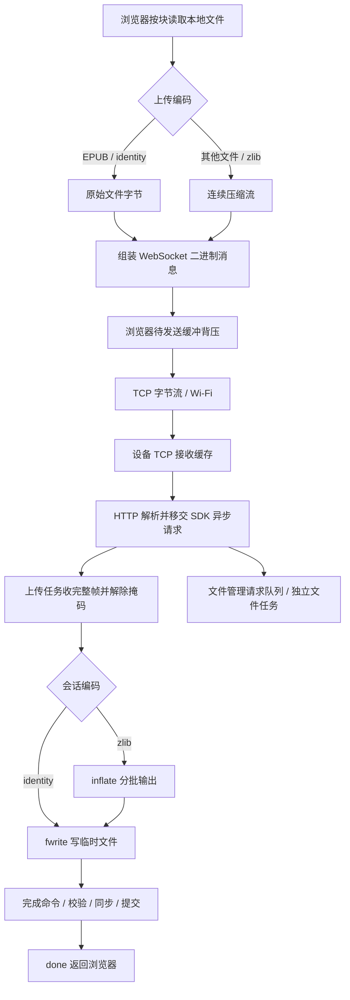

# 470 网页文件传输实现

本文说明 `xingzhi-ai-470` 的热点与 WIFI 网页文件传输实现，包含网络生命周期、数据处理、流控、内存、文件保护和 S31 配置。实际行为以源码和 `sdkconfig` 为准。

## 1. 使用方式与服务边界

网页文件管理提供两种连接方式，页面资源内置，无需外网。

- **热点传输**：在传输页打开 `Metalio-xxxx` 热点，电脑或手机连接后访问 `http://192.168.4.1/`。
- **WIFI传输**：在传输页选择“WIFI传输”，顶部保留传输方式选项，下方扫描时仅显示一条居中提示，完成后先显示扫描结果，再展开“已保存”和“未保存”两个列表。各组标题显示网络数量，列表带独立边框，并各自按信号强度从高到低排列。列表框高度随各组网络数量自适应，并限制在传输外框内；超出时仅在各自框内上下滑动条目，标题和边框底线始终可见，不显示页码或翻页按钮。“刷新”按钮位于未保存列表框下方，与列表及内容底部保留间距。附近没有已保存网络时，该组缩小并居中显示“附近暂无已保存网络”。点击已保存网络使用现有密码连接；未保存的加密网络需要输入密码，开放网络直接连接。点击信号右侧的圆框“!”可重新输入密码连接，适用于已保存和未保存网络。连接失败后再次点击可重新输入密码。
- 连接成功后在传输页内容区显示设备网址及二维码，点击“返回列表”可继续选择网络。手机或电脑连接同一个 Wi-Fi 后，访问设备显示的网址即可上传、下载和管理文件，无需重启设备。网址由路由器分配，重新连接后可能变化。
- 切换传输方式或离开传输页会关闭网页服务。选中 AP 或 WIFI 传输后，从准备、扫描到网页传输期间均保持唤醒和网络，不因长时间无操作自动待机或关闭网络；HTTP 连接超时仅清理失效连接，不停止网页服务或热点。路由器若启用访客网络隔离或客户端隔离，同一 Wi-Fi 内的设备仍可能无法互访。

两种连接方式共用文件管理网页、上传协议及文件保护逻辑。服务使用明文 HTTP/WebSocket，未设置访问密码；请只在可信网络启用，网络内可访问设备的客户端能够读写 SD 文件，包括保存的 Wi-Fi 配置。

- 网页、目录、容量、文件管理和下载使用 HTTP。
- 上传使用当前网页主机同端口的 `/ws/upload`，由 HTTP 握手升级为 WebSocket。
- WebSocket 同时承载开始、完成、取消、心跳命令，二进制文件正文，以及设备进度。
- 浏览器维护串行队列，每个文件使用独立连接；设备同一时间只接受一个上传任务。
- 热点模式为开放 AP；Wi-Fi 模式使用选定网络的现有安全配置。网页服务均与 STA 配网门户分离。

## 2. 源码位置与职责

- [ap_transfer.cc](../main/display/screen/cloud_screen/ap/ap_transfer.cc)：AP/HTTP 启停、路由、WebSocket 会话、数据解压、文件写入和提交。
- [ap_transfer.h](../main/display/screen/cloud_screen/ap/ap_transfer.h)：传输服务对外入口。
- [ap_request_worker.cc](../main/display/screen/cloud_screen/ap/ap_request_worker.cc)：内部有界异步请求队列、PSRAM 工作任务及停止屏障。
- [fileman.html](../main/display/screen/cloud_screen/ap/fileman.html)：文件管理界面、队列、压缩、发送背压、进度与取消。
- [cloud_chrome.cc](../main/display/screen/cloud_screen/cloud_chrome.cc)：页面无线模式切换与结果回传。
- [pack_ap_fileman.py](../scripts/pack_ap_fileman.py)：内嵌页面图片并生成 gzip 资源。
- [SdCardManager.cc](../main/boards/common/storage/SdCardManager.cc)：SD 挂载、总线配置及 DMA 对齐中转缓冲。
- [wifi_station.cc](../components/esp-wifi-connect/wifi_station.cc)：STA 启停及每次启动时应用功率限制。
- [wifi_station.h](../components/esp-wifi-connect/include/wifi_station.h)：470 的固定 TX 功率请求上限。
- [sdkconfig.defaults.esp32s31](../sdkconfig.defaults.esp32s31)：S31 默认配置；当前构建配置见 [sdkconfig](../sdkconfig)。

引脚和外设参数继续以板型配置为准，本文件不复制引脚表。

## 3. AP 与服务的生命周期

热点启动入口为 `ApTransferStart()`，主要顺序如下：

1. 串行保护无线切换，检查待机约束及是否已经启动。
2. 准备事件循环、AP 网络接口及 DHCP 地址。
3. Wi-Fi 未初始化时创建驱动；已经初始化时暂停原 STA，记录恢复所需状态。暂停标志先于停止扫描和射频生效；后台连接回调检查暂停状态与当前模式，模式切换期间的配置、连接错误结束本次尝试，不触发断言重启。
4. 切换到纯 AP，启动热点，关闭 Wi-Fi 省电，设置本板型最大 TX 功率。
5. 创建独立上传任务和文件管理任务，再启动端口 80 的 HTTP 服务，注册普通路由和 `/ws/upload`；不增加端口或更改浏览器协议。

启动中途失败走已有关闭路径，避免遗留半初始化服务。无线切换复用单个后台任务，页面存续期间以通知阻塞等待，栈优先使用 8 KiB PSRAM；离页提交停止请求，关闭完成后退出并释放栈。热点模式的 UI 不等待 HTTP、Wi-Fi 或工作任务退出。

Wi-Fi 模式在扫描和连接任务完成关联及 DHCP 后调用 `WifiTransferStart()`，借用网络页持有的 STA，仅启动同一套 HTTP 服务，不创建热点、不接管 STA 射频。传输页的射频任务先完成旧热点关闭，再在内容区构建 WIFI 面板。切换模式或退出时，面板中断扫描或连接任务，关闭文件服务后释放本地 STA，恢复进入前的网络管理状态；不等待射频任务退出，避免双方相互等待。扫描记录和扫描任务栈优先使用 PSRAM；连接任务会保存网络配置到 NVS，因此使用内部 RAM 栈，以满足 Flash 写入期间关闭缓存的要求。密码键盘在打开输入页时创建，关闭输入页后释放按键。

停止入口 `ApTransferStop()` 先禁止新请求并标记上传取消，关闭所有已登记客户端 socket 的读写方向，唤醒包括半个报头、上传正文和文件响应在内的阻塞读写。两个工作队列排空后再停止 HTTP；此时 SDK 关闭连接并投递会话回收，上传任务处理完这些回收项后退出，再退出文件管理任务，最后关闭 Wi-Fi。启动中途失败也走同一顺序，不直接在注册路由失败处停止仍有异步请求的 HTTP 服务。按调用参数及原 STA 状态恢复联网；切换 U 盘或待机等路径可以不恢复 STA。

上传期间允许浏览目录、读取容量和追加浏览器队列；无关文件仍可新建、删除、改名或移动。设备拒绝操作当前上传目标、删除或改动其父目录，以及将其他项目改名或移动到当前目标。目标路径借用活动会话缓冲，受上传状态锁保护，完成或失败时清除。上传期间禁止下载，网页点击文件也只提示，不跳转离开上传页。HTTP 服务只解析和分派请求，上传与文件管理分别在独立任务处理。上传开始、提交和清理与文件目录变更共用递归互斥，防止路径校验与执行之间发生竞态；上传中的分块写入不持有该管理锁，由同卷 FatFs 锁保护实际 SD 操作。目录快照构建完成后提前释放管理锁，再发送 JSON，慢客户端不会因此长期占用管理锁。物理 SD 卡和总线仍共享，目录扫描、递归删除或文件提交仍可能影响吞吐和元数据操作延迟。设备其他业务也必须避免操作上传目标文件；这里只保护传输服务自身的操作。

## 4. 数据链路总览



当前应用层在独立 `ap_upload` 任务中执行“接收一帧 → 解压/写入 → 完成异步请求”。`ap_files` 独立处理目录、容量和文件管理请求，HTTP 服务任务不再等待正文接收、解压、写卡或递归删除。每个连接至多一个 SDK 异步请求在途；SDK 完成通知后才恢复该连接的读取，以 TCP 接收窗口形成背压。每个任务队列固定 8 项，全服务最多 4 个客户端，上传会话也受 4 个名额限制；队列保存请求描述符，不另行复制多帧正文。这是有界单帧处理，未增加接收/写卡双缓冲流水线。底层 Wi-Fi 和 TCP 仍可缓存后续数据。

SDK 默认处理 WebSocket PING/CLOSE，PONG 继续投递上传任务，用于现有心跳确认。CLOSE 不异步移交，避免 SDK 在请求完成前回收会话；关闭回调只投递上传任务进行文件清理与内存释放。接收失败会关闭连接读写并完成异步请求，随后 SDK 回收会话。客户端描述符登记锁保证退出时的 shutdown 不会误操作已关闭并复用的描述符。

## 5. 上传协议与状态

### 5.1 开始与准备

浏览器先检查容量及队列预留空间，建立连接后发送文本 JSON。例如上传一个 12345 字节的 EPUB：

```json
{"op":"start","id":"upload-1","path":"/","name":"example.epub","size":12345,"replace":false,"encoding":"identity"}
```

设备检查名称、目录、大小、容量、同名保护和遗留临时文件，创建 `.part` 后返回：

```json
{"event":"ready","id":"upload-1","state":"receiving","total":12345,"received":0,"written":0,"wire":0,"active":true,"error":"","chunk":4096,"encoding":"identity"}
```

浏览器检查任务 ID、计数、状态、分块大小和编码一致后才发送正文。会话在握手后的首条数据到达时创建，适配当前 ESP-IDF 6.1 握手处理流程。

任务 ID 长度为 1～31 个字符，仅接受小写字母、数字和连字符。任务归属创建它的连接，其他连接不能发送正文、取消或完成该任务。设备保留最近一个任务结果，拒绝该 ID 的重复上传。

开始失败返回 `event:"error"` 和错误说明。编码不支持或协商不一致时停止，不静默切换编码。

### 5.2 正文、进度与完成

正文以二进制消息发送，最后一块可短于约定块大小。线上载荷跨过每个进度边界后，设备推送 `event:"progress"`；进度用于展示和校验，不驱动浏览器续发。

- `total`：声明的原文件字节数。
- `wire`：收到的二进制载荷字节数，不含 WebSocket/TCP/IP 帧头。
- `received`：交给写入函数的原文件字节数；压缩模式下是解压后的数量。
- `written`：`fwrite()` 实际返回的写入字节数，不代表最终同步已完成。

浏览器百分比及速率按 `received` 计算。压缩模式的原文件处理速度可能高于线上载荷速度；比较吞吐时应同时看原文件大小、`wire` 和总耗时。页面绘制最多约每 100 ms 更新一次。

正文和压缩尾部全部排入 WebSocket 后，浏览器发送：

```json
{"op":"finish","id":"upload-1"}
```

同一连接的有序传输保证完成命令排在此前正文之后。设备验证通过后立即返回最终接收进度并进入 `saving`；同步及提交成功后返回 `done`、`active:false`。浏览器只有确认 `done` 且写入量等于文件大小，才结束本项并开始下一项。

状态路径为 `receiving → saving → done`；错误和取消分别结束为 `failed`、`cancelled`。

文件提交成功后使阅读书库缓存失效，下次进入阅读或书架时重新扫盘；AP 删除（含部分删除）、改名、移动及备份恢复也同步失效缓存。失败或取消的上传不按成功提交处理。壁纸在进入应用时重新扫描 `metalio/e-ink/wallpaper` 本层；书籍需位于 `metalio/e-ink/books` 或其子目录，上传到其他位置不会自动加入应用列表。App 推送书籍下载完成后已有书库缓存失效处理，壁纸同样在进入应用时扫盘。

阅读设置每次打开或切换到字体页签时，先在字体容器内显示“字体加载中…”，再由单个低优先级任务扫描 `metalio/e-ink/fonts` 本层；完成后由 UI 发布列表。切走页签、关闭阅读或待机会作废扫描结果，快速返回时等待旧任务退出后再启动新一轮，后台不操作控件或共享字体列表。扫描失败显示容器内错误提示，空目录显示原有空态；列表重绘和多选操作不重复扫描。AP 上传或 App 推送的 `.ef` 字体在下次进入该页签时显示，不要求重开书籍，扩展名不区分大小写。

TTF/OTF 保存在 `metalio/e-ink/fonts_ttf`，通过“导入 TTF”转换后加入已安装字体列表。字号范围为 20–80px，默认 40px，长按加减按钮可连续调节。字体卡片一页显示六项；TTF 确认页和进度页与字体列表共用加高后的卡片，内容固定在一页内且不可滚动，仅文件列表显示分页按钮；长文件名单行居中省略，保留首尾。“开始转换”保留源文件名（去掉最后一个扩展名），追加 `_字号_2.ef`，例如 `霞鹜臻楷.ttf` → `霞鹜臻楷_40_2.ef`，中文、空格和原有标点均保留；输出名称过长时提示缩短源文件名，不自动改名。转换进度约每 3 秒刷新，完成后返回 TTF 列表并显示 3 秒黑底白字顶部提示。“直接应用”按所选字号直接加载源 TTF/OTF，返回阅读正文，无需生成 `.ef`；字体与字号会保存，并在重开书籍或待机唤醒后恢复。直接加载期间需保留 SD 卡中的源字体文件，字形按需读取和渲染；整页图片书籍仅保存字体选择，进入文字书籍后生效。

The font card shows six entries per page. TTF confirmation and progress use the same taller card, with all content visible on one page and scrolling disabled. In Import TTF, choose a size from 20–80px (default 40px). Convert preserves the source filename without its final extension and appends `_size_2.ef`, preserving Chinese characters, spaces, and punctuation. If the output name exceeds the filename limit, shorten the source filename; it is never renamed automatically. Apply directly loads the source TTF/OTF at the selected size and returns to reading without generating an `.ef` file. The font and size are saved and restored when reopening a book or waking from standby. Keep the source font on the SD card: glyphs are read and rendered on demand. Image-only books save the selection for use in text books.

直接应用复用验证成功的字体实例。分页使用独立的测宽视图，可选占用 128 KiB PSRAM 缓存 BMP 字符的准确步进，避免反复测宽挤占绘制缓存；申请失败时沿用原度量路径，非 BMP 字符按需测量。绘制前分批预热当前页字形，已缓存的批次直接复用。完整度量和 A8 位图采用四路组相联缓存，减少字形相互覆盖；位图缓存上限为 384 KiB。字体流另使用最多 64 KiB 的 PSRAM 读窗口，申请失败时回退直接读取；预取失败时重试本次所需范围。缓存随字体关闭释放。正文绘制后再启动整书页数统计，翻页中断后保留已完成章节的统计。字体读取及渲染错误日志保留 FreeType 错误码和字形索引；同一字体实例的重复错误按 5 秒间隔限频，并记录抑制次数。缺字及正常待机取消不打印错误日志。

Direct application reuses the validated font instance. A separate layout view optionally uses 128 KiB of PSRAM to retain exact BMP character advances, keeping repeated measurement out of the drawing cache. Allocation failure uses the original metric path; non-BMP characters are measured on demand. Visible-page glyphs are warmed in batches, and cached batches are reused immediately. Full metrics and A8 bitmaps use four-way set-associative caches to reduce collisions, with a 384 KiB bitmap budget. The font stream uses up to 64 KiB of PSRAM read windows, falling back to direct reads if allocation fails. Failed prefetches retry only the requested range. Caches are released when the font closes. Whole-book page counting starts after the page is drawn and retains completed chapter counts when interrupted by navigation. Font read and render logs include FreeType error codes and glyph indices. Repeated errors from the same font instance are limited to one message per five seconds, including the suppressed count. Missing glyphs and normal standby cancellation do not produce error logs.

“直接应用”与“开始转换”等宽对齐。后台正在编排时仍接受应用请求，取消旧编排并待其退出后验证新字体；验证成功才更新字体偏好，失败保留原字体。等待期间再次选择字体时使用最新选择。

Apply directly aligns with Convert at the same width. Requests are accepted during background layout; the old layout is cancelled before validating the new font. Preferences change only after validation succeeds, and failure preserves the previous font. A newer font choice replaces a pending selection.

TTF/OTF 文件列表支持长按进入多选、全选、取消及删除，可跨页选择。删除源字体不会删除已转换的 `.ef` 文件；删除当前直接应用的源字体时，先切回已安装字体或默认字体。

Long-press a TTF/OTF file to enter selection mode, select files across pages, select all, cancel, or delete. Deleting source fonts keeps converted `.ef` files. Deleting the active source font first switches reading to an installed or default font.

已有字体时复用当前字体的字集；字体列表为空时使用内置阅读字集，无需预先放置 `.ef` 文件。内置范围与 PC 工具的 `reading_zh` 一致，包含基础拉丁字符、常用汉字及中英文标点；仅转换源 TTF/OTF 中实际存在的字形。转换耗时和内存占用取决于可用字形数量及所选字号，内存不足时可减小字号。

When fonts are installed, conversion reuses the current font's character set. An empty font list uses the built-in reading character set and requires no existing `.ef` file. Its ranges match the PC tool's `reading_zh` preset, covering basic Latin characters, common Chinese characters, and Chinese and English punctuation. Only glyphs present in the source TTF/OTF are converted. Conversion time and memory use depend on the available glyphs and selected size; reduce the size if memory is insufficient.

同名 .ef 文件将被覆盖，转换期间请勿拔出 SD 卡。取消、返回、切换页签、退出阅读、待机及正常关机均请求取消，后台关闭文件并清理临时输出后退出，收尾期间不能启动新转换。确认或转换中返回、取消以及待机唤醒后回到“导入 TTF”文件列表；列表页再次返回才退出到“选择字体”页。

写入使用临时文件，替换旧字库失败时尝试恢复备份；异常断电遗留的 .bak 在下次转换同名字库时恢复或清理。物理拔卡或突然断电可能留下临时文件，无法保证立即清理。

## 6. 压缩机制

### 6.1 identity 与连续 zlib

EPUB 按原文件扩展名判断，不区分大小写，使用 `identity`：整个 EPUB 容器逐字节原样传输，不展开章节和图片，也不再次压缩其内部 ZIP 数据。

其他文件在浏览器可创建 `CompressionStream("deflate")` 时协商 `zlib-stream-v1`。这是一条完整文件的 zlib 包装 DEFLATE 流：

- 压缩字典跨读取块和 WebSocket 帧保留，不逐块重建。
- 压缩器输出与源文件读取块不一一对应；小段输出先聚合，尾部不足一帧也发送。
- 设备复用 `inflate` 状态，以固定输出缓冲循环解压和写入，不展开整个文件。
- 设备要求流结束、Adler-32 校验通过、无尾随数据，且原文件字节数精确匹配声明。
- 空文件在压缩模式下仍发送完整的空 zlib 流；identity 空文件只执行开始与完成。

浏览器不能创建压缩器时，从开始就使用 identity。连续压缩一旦开始，运行中失败即终止，不逐块回退。当前只有 EPUB 被按类型排除，ZIP/JPEG 等其他已压缩格式仍可能进入 zlib 路径，收益需实测。

### 6.2 与网页压缩及掩码的区别

页面源由构建脚本内嵌标识图片并生成 `ap_fileman.html.gz`，嵌入 Flash；设备直接发送 gzip，浏览器展开，设备不在 RAM 解压页面。打包时图片与页面分别结束 DEFLATE 块，减少内嵌 base64 对压缩率的影响。

网页 gzip、上传应用层 zlib、EPUB 内部 ZIP 是不同处理层。上传不启用 WebSocket `permessage-deflate`；客户端掩码由 SDK 解除，属于协议异或处理，不是压缩或加密。

## 7. 发送节奏与 TCP 流控

### 7.1 浏览器背压

浏览器每次发送前检查 `ws.bufferedAmount`。超过阈值时，等待后重复检查，同时响应取消和连接关闭；不是每发送一帧固定休眠。

这个值表示浏览器尚未传送出去的 WebSocket 数据，不涵盖已进入网络和设备的数据。阈值也不是绝对上限：检查通过后再发送一帧，会使待发送缓冲继续增加。发送端根据浏览器待发送缓冲控制速率，无需等待设备进度确认后再发送下一帧。

### 7.2 TCP 拆分、确认与停顿

TCP 传递连续字节流，不保留应用消息边界。一个 WebSocket 帧可跨多个 TCP 段，一个 TCP 段也可包含不同帧的内容；SDK 按 WebSocket 帧头长度重新组装消息。

接收端按字节序号排序，ACK 确认连续收到的数据；启用并成功协商 SACK 时，可以附加报告乱序到达的区间。缺口未补齐时，后续数据不能越过缺口交给上层，这会使同一连接上的正文、进度和心跳受到队头阻塞影响。

发送还受接收窗口及发送端拥塞控制约束。设备应用读取不及时会使 TCP 接收额度减少，额度归零时对端暂停正常的新数据发送，等待窗口恢复。应用读走 socket 数据后可能释放接收额度，无须等 SD 同步完成；但串行写卡会延后下一次读取，仍可能间接造成背压。

TCP ACK、设备 progress、设备 done 分别对应协议栈接收、应用处理、文件提交完成，不能相互替代。单看发送间隔不足以区分浏览器节流、窗口限制、重传或设备处理耗时。

上传连接在会话创建时启用设备端 `TCP_NODELAY`，设置失败关闭连接。它用于减少设备小消息的 Nagle 等待，不修改浏览器 TCP 策略，也不能消除丢包、拥塞或写卡停顿。

## 8. 缓冲与 SD 写入

上传相关大小在各自源码处维护，当前为：

- 源文件读取及 WebSocket 载荷：每块最多 4 KiB。
- 浏览器待发送缓冲检查阈值：8 KiB；等待后每 5 ms 检查。
- 设备接收缓冲：4 KiB，加 1 字节文本结束符。
- 压缩模式解压输出：每批最多 16 KiB；zlib 滑动字典最多 32 KiB，另有状态内存。
- 设备进度：每跨过 64 KiB 线上载荷边界反馈一次；完成、失败及取消立即反馈。

上传会话对象及接收缓冲按连接创建并复用，启用 PSRAM 时仅从 PSRAM 分配，不回退挤占内部 RAM。解压输出、zlib 状态和字典按需分配于 PSRAM，identity 不创建解压资源。连接关闭后由上传任务释放全部会话资源并归还会话名额。

HTTP、上传和文件管理任务各用 16 KiB 栈，本项目启用外部任务栈后均放 PSRAM；两个工作任务只在热点期间存在。队列内容缓冲也放 PSRAM，控制块和少量锁/描述符登记使用静态内部 RAM。SDK 异步请求的元数据分配沿用 SDK 和系统堆策略，任务 TCB 仍有内部 RAM 成本；固定连接数与队列长度限制其上界。新增任务栈共 32 KiB PSRAM，并非每个文件新建任务。上述缓冲不是总内存预算，还需计算 Wi-Fi、lwIP、stdio/FatFs、任务及其他业务占用；内部 RAM 和 DMA 历史最低值仍需硬件验收。

写入路径为 `fwrite → stdio → FatFs → SDMMC → SD 卡`。S31 挂载时准备共享的 4 KiB 对齐内部 DMA 中转缓冲，供 SDK `dma_aligned_buffer` 使用；主机缓冲检查拒绝 PSRAM 直接 DMA，使外部数据由 SDK 复制后按最多 8 扇区中转。已对齐的内部数据仍可直接传输。相较此前 PSRAM 中转方案增加约 4 KiB 内部 DMA 常驻占用，释放卡时回收；上传缓冲、解压缓冲和任务栈仍优先放 PSRAM。其他芯片保留 512 字节内部 DMA 缓冲。此为隔离 S31 外部 DMA/cache 同步影响的保守配置，尚未真机确认超时根因。

同卷 FatFs 锁保护 SD 访问及共享中转缓冲；USB 导出必须维持本机与主机互斥。USB 工作任务按请求创建并退出，不在关闭路径初始化 USB，也不因进入面板而预建工作任务。

## 9. 文件保护与最终提交

上传正文先写入目标目录的 `.cz-<文件名>.part`，原文件在接收期间保持不动。容量按新文件完整大小预留，不提前释放旧文件空间。

收到完成命令后先校验长度及压缩流状态，再依次执行：

1. 推送 `saving`，界面显示设备保存中。
2. `fflush()` 刷新 stdio 缓冲。
3. `fsync()` 请求文件系统同步。
4. `fclose()` 关闭文件并检查结果。
5. 重新检查目标状态；显式允许覆盖时，将旧文件改名为 `.cz-<文件名>.bak`。
6. 将 `.part` 改名为正式文件；失败时尝试还原旧文件，成功后清理备份。
7. 推送最终结果。

同步、关闭及提交与退出请求配合保护，写入错误按已知 errno 区分空间不足、内存不足和 SD I/O 错误。通用 I/O 错误不推断为 DMA 或容量问题。

浏览目录或开始上传时，恢复逻辑会清理未提交临时文件、恢复遗留备份；活动上传目标及其相关临时文件会被跳过，其余遗留备份仍正常恢复，避免管理操作覆盖未恢复的原文件。该方案保护正常断线和可恢复的文件操作失败，不构成文件系统级断电原子事务；介质损坏、断电及恢复边界仍需真机验证。identity 没有额外的应用层整文件哈希校验，验收时需在主机比较原文件和回读文件哈希。

## 10. 取消、断线和超时

用户取消时，浏览器停止读取和发送新块，再通过所属连接发送：

```json
{"op":"cancel","id":"upload-1"}
```

已经排入 TCP 的字节无法撤回，取消命令需要排在它们之后处理，因此取消不是立即丢弃全部在途数据。设备关闭并删除未提交文件后回报 `cancelled`。进入保存阶段后网页不再提供取消按钮。

断线、无效帧或写入失败会触发会话清理。退出 AP 使用 socket 中断唤醒阻塞接收并等待收尾。若提交已完成但最终响应丢失，浏览器无法仅凭断线判定成功或失败，会提示重新连接、刷新目录确认，不自动重传；手动重试使用新任务 ID。

- socket 单次接收、发送等待超时：均为 60 秒，不是整文件期限。
- 网页无有效进度响应超时：120 秒。
- ready 后每 60 秒发送带任务 ID 的 `op:"ping"`，设备触发原生 WebSocket Ping；浏览器自动 Pong，设备再发送 `event:"pong"` 通知页面。
- 下一心跳周期仍未收到 Pong 通知则终止；保存或取消中不再发起心跳。
- Pong 不重置进度超时；完成、失败、取消均清理定时器。
- TCP keepalive 配置为空闲 10 秒、间隔 5 秒、3 次探测，辅助发现失联。

## 11. 文件管理接口与限制

- `/api/storage` 返回挂载状态和总量、剩余容量；网页检查队列预留，设备开始每项时再次检查。
- `/api/files` 返回目录，最多展示 200 项，截断时明确提示。目录不完整时网页停止添加该批上传，设备仍执行同名文件保护；列表暂存放 PSRAM。
- `/download` 使用 HTTP，逐次从 SD 读取 1 KiB 并发送响应，不使用上传的压缩编码。
- `/mkdir`、`/delete`、`/rename`、`/move` 管理目录和文件。递归删除使用迭代遍历，不累积目录句柄与递归栈，失败即停止并报告已删除数量。
- 名称最多 246 个 UTF-8 字节（中文通常约 82 字，含扩展名），网页路径最多 511 字节；名称为 `.cz-` 和 `.part` 预留 9 字节，确保临时文件也不超过 FAT 长文件名上限；HTTP URI 缓冲同步扩大到 1600 字节；拒绝越界路径和根目录删除。
- `.cz-` 为传输服务保留前缀，网页不能直接操作这些文件。
- 文本命令最多 1280 字节，拒绝 WebSocket 分片消息、超长二进制帧、超出声明长度的输出、压缩校验错误、截断和尾随数据。
- 更新设备固件后请重新加载网页，确保页面与传输接口版本一致。

上传过程中可继续选择文件、查询目标目录并追加队列；记录按新任务在顶部展示，实际发送仍为先加入先发送。同名文件可选择保留两份、替换或跳过，并可应用于该批冲突。关闭上传面板只收起界面，不清空队列；清除记录只移除完成、失败和取消记录，不删除 SD 文件。“取消本次添加”只取消对应添加批次。

删除确认支持逐项移除和长名称展开，全部移除后不发送删除请求；删除失败或断线后刷新确认，已删除内容无法撤销。

## 12. S31 无线配置

- TCP 接收窗口 32768 字节、发送缓冲 5760 字节、MSS 1440。
- TCP 接收邮箱和 TCP/IP 接收邮箱均为 32 项，accept/UDP 邮箱均为 6 项。
- 动态 RX 上限 32、静态 RX 6、RX BA 窗口 12、静态管理接收缓冲 5。
- 启用 TX/RX A-MPDU，TX BA 窗口为 64，乱序 pbuf 上限为 12，并启用 SACK。
- Wi-Fi/lwIP 优先使用 PSRAM，静态 TX 数量为 6，缓存 TX 数量为 4。

STA 使用 b/g/n 协议并关闭省电。静态 RX 与 BA 窗口的关系、TX 缓冲类型需满足所用 SDK 的配置约束。

STA 和 AP 传输的 TX 功率请求上限为 12 dBm，常量位于 `wifi_station.h`，每次启动时应用。SDK 可能量化功率档位，实际射频输出还受硬件和工作条件影响。AP 频道及连接数见 `StartRadio()`。

## 13. 日志与存储故障

上传进度以设备接收的原文件字节数为准。吞吐测试应使用相同文件、电脑、距离和无线拓扑，区分线上传输速度与解压后的文件处理速度。

上传写入、刷新或同步返回 EIO 时锁存内存卡故障，停止接受新上传；当前上传收尾后，设备传输界面显示“内存卡状态异常，请重启设备后再试”及“重启”按钮，重复错误不叠加窗口。点击后由应用线程关闭 AP 传输再重启；空间不足和内存不足不触发此窗口。此处按实际存储返回值识别，不解析 SDK 日志，也不覆盖其他业务的独立 SD 故障。

页面退出/重建只通过 `CloudRadioAbandon()` 标记停止和使旧代结果失效。停止意图与最新模式分别保留，快速退出重进也会先完成旧 HTTP、上传/文件任务及射频清理，再启动最新模式；所有等待均在同一射频任务执行。待机请求立即禁止新 AP 启动，后台关闭且不恢复 STA；唤醒沿用同一调度顺序。任务创建失败不在 UI 同步回退启动/关闭。STA 暂停接口在 AP 模式下拒绝停止整个 Wi-Fi；已开始的联网等待发现纯 AP 后提前退出，避免旧超时干扰热点。软件启动成功不代表已验证空口广播，热点可见性仍需真机扫描确认。

## 14. 构建与 SDK 补丁

两个 OTA 应用分区各为 5 MiB，固件须通过构建中的 `app_check_size` 分区大小检查。

`patches/esp-idf/sdmmc-preserve-write-error.patch` 用于保留 SDMMC 多块写入的原始错误码，避免恢复查询覆盖写入失败。它不解决存储卡或总线本身的 CRC 故障。

在对应 ESP-IDF 根目录执行 `git apply --check <补丁绝对路径>`，确认适用后再执行 `git apply <补丁绝对路径>`。已应用的环境无需重复操作；更换 SDK 时需检查补丁兼容性。
