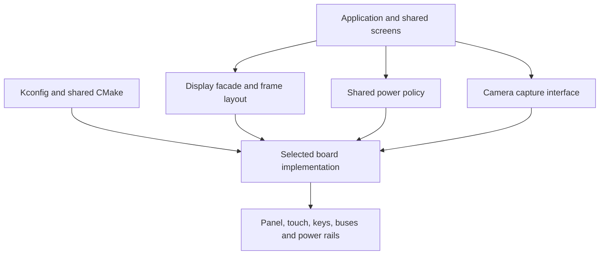
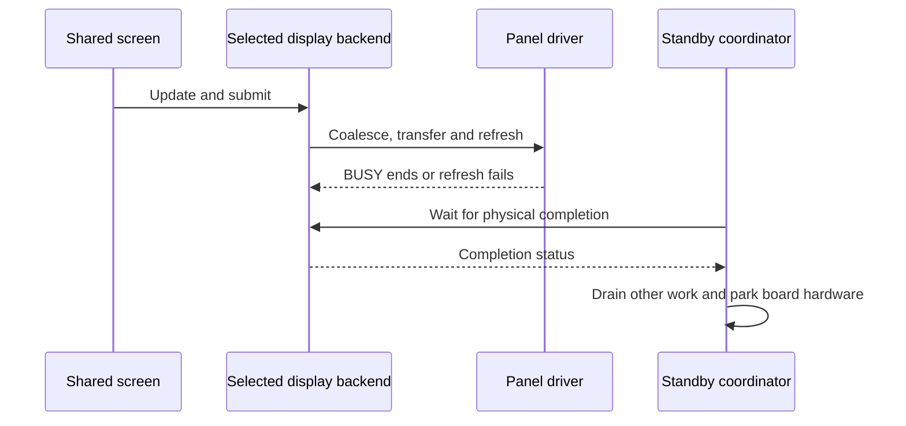

# Multi-board framework and hardware integration

[简体中文](hardware-adaptation_zn.md)

See the [hardware test matrix](hardware-test-matrix.md) for board results and regression scope.

## Scope

Reading, screens, conversation, protocols, audio processing and data storage share one implementation. Board selection determines the chip, display and camera backends, wiring, power operations, fonts and images. A firmware build contains only the selected board's hardware implementations; it does not discover and switch complete board profiles at runtime.

Software is grouped into `sysmgmt`, `business`, `infra` and `ui`; hardware stays in `boards`, and resource files stay in `assets`. `Board` retains existing device entry points. New hardware coordination uses the relevant contracts rather than expanding Board into a business manager.

Available build profiles, with Global variants sharing their hardware directory:

- `470`, `470-global`: `metalio-e-ink4-plus`, ESP32-S31, EPDiy.
- `397`, `397-global`: `metalio-e-ink-4`, ESP32-S3, SSD1677.

Each board retains its existing hardware identity. Different wiring must not impersonate another board. Release and flash the matching profile.

Firmware recovery from allocation failures requires SDK C++ exception support. Shared defaults enable `CONFIG_COMPILER_CXX_EXCEPTIONS`. The emergency exception pool must also retain the shared default minimum. Existing build directories must update both options in their selected `sdkconfig`; adding compiler flags to `main` alone does not configure the SDK. Account for exception code and memory overhead in each board's partition and RAM budgets.

Both board profiles use CMake interprocedural optimization for their own `main` component and the corresponding final link. SDK and third-party libraries retain independent compilation; exception unwind information remains enabled. `main/ui/common/drawing/font/freetype_modules.h` registers the TrueType/OpenType drivers accepted by reading and conversion, retaining CFF, hinting and renderers. FreeType includes this list multiple times, so it has no header guard. These build policies do not change the application API version or persisted formats. Toolchain upgrades still require checking wrapped entry points, font output and device behavior.

## Directory structure

```text
main/
├─ app_main.cc
├─ CMakeLists.txt, Kconfig.projbuild, idf_component.yml
├─ sysmgmt/
│  ├─ application.*, application_tasks.cc
│  ├─ power/power_lifecycle.*, power/policy/
│  ├─ time/network_time.*, audio/audio_runtime.*, display/, diagnostics/, ui_startup.*
│  ├─ device_state.*, device_state_event.*
│  └─ system_info.*
├─ business/
│  ├─ reader/, app_store/, workbuddy/, yunxin_binding/, mcp_tool/
│  ├─ cloud/, transfer/, wallpaper/, haptics/, checklist/, weather/
│  ├─ network/, bluetooth/, diagnostics/
│  └─ conversation/
│     ├─ chat_cloud.h, chat_memory.h
│     ├─ yunxin/
│     └─ vision/camera_vision.*
├─ infra/
│  ├─ audio/
│  │  ├─ audio_service.*, audio_service_capture.cc
│  │  └─ processors/pcm_audio_processor.*
│  ├─ network/http/, endpoints/, time/
│  ├─ image/raster_image.h, image_decode.*, image_stream.*, image_overlay.cc, jpeg/
│  ├─ protocols/                      # WebSocket, MQTT, MCP
│  ├─ diagnostics/firmware_memory.h
│  ├─ ota/
│  └─ storage/settings.*, sd_paths.h, sd_layout.cc, sd_data_layout.*, sd_file_commit.*, sd_work_file.h
├─ ui/
│  ├─ application_ui.*              # Application/navigation bindings
│  ├─ home/
│  ├─ apps/                         # book, assistant, workbuddy, app_store, cloud, wallpaper, checklist
│  │  ├─ settings/                  # network, bluetooth, pager, settings_test
│  │  ├─ standby/
│  │  └─ update/
│  └─ common/
│     ├─ runtime/                  # lifecycle, navigation, input/, lvgl/
│     ├─ widgets/                  # shared controls and presentation
│     └─ drawing/                  # display, adapter/, rendering/, font/, a2ui/
├─ assets/
│  ├─ device/, fonts/, embedded/, factory-test/
│  ├─ locales/, lang_*.h, lang_home.cc
│  └─ profiles/compact/
│     ├─ resources.list
│     └─ device/
└─ boards/
   ├─ metalio-e-ink-4/
   │  └─ metalio_e_ink_4_board.cc, config.h, sdkconfig.defaults
   ├─ metalio-e-ink4-plus/
   │  └─ metalio_e_ink4_plus_board.cc, config.h, sdkconfig.defaults
   └─ common/
      ├─ board/, bus/i2c/, bluetooth/
      ├─ audio/                       # audio_codec.*, bluetooth/, other existing codecs
      ├─ display/ssd1677/, epdiy/      # epdiy includes panel/, tps65185/, waveforms/
      ├─ input/buttons/, touch/
      ├─ camera/uvc/, dvp/
      ├─ power/bq27220/, cx25601n/, topology/, s31_sleep/
      ├─ rtc/pcf8563/, sensor/sc7a20h/
      ├─ io/pca9555/, tca95xx/
      ├─ haptics/vibration.*
      ├─ storage/
      └─ monitor/system_monitor.*
```

## Module boundaries

UI code is organized into home, applications and shared components. Pages own widgets, UI timers and subscriptions; leaving a page removes subscriptions and invalidates stale results. Each business domain owns cancellation, saving and resource cleanup. Leaving a page does not imply that its operation has completed.

Reader preferences and NVS migration belong to `business/reader/book_reader_prefs.*`; ELF data transactions belong to `business/app_store/app_data_store.*`. Neither includes UI headers. Conversation code delivers state and intent through `conversation_presentation.h`, whose implementation is provided by the UI without exposing LVGL widgets. System presentation requests use `sysmgmt/system_notice.h`.

Built-in application names, icons and initial pages are registered in `ui/application_ui.*`; home layouts only define ordering. Home and standby open the checklist by application ID, with hardware wake completed before standby navigation. `business/checklist` provides refresh, delete and complete operations independently of the UI. Startup, conversation and checklist views share request admission and cache commits. Views hold read-only results and display snapshots; leaving a view does not interrupt operation cleanup. Business execution releases its network hold before publishing results, and batch updates retain retry and partial-success behavior.

Home and standby independently subscribe to snapshots through `ui/common/widgets/weather_view.*`; refresh workers belong to `business/weather`. Network and cloud share QR rendering. Application initialization binds the home factory, navigation preparation and network entry, so shared navigation does not include concrete pages. Directory changes preserve application IDs, NVS keys, persistent paths and the ELF ABI.



System code owns lifecycle and cross-feature coordination. Business code owns product behavior; infrastructure owns execution mechanisms; UI owns presentation. Folder placement does not replace dependency review or introduce a capability base class or event bus.

Transfer, cloud resources, checklists, weather, wallpaper selection and haptic preferences belong to their feature modules; conversation storage belongs to the conversation module. Screens submit operations and display results. Shared downloads and cancellation live in `infra/network/http`; shared audio packet types live in `infra/audio`.

System lifecycle code coordinates power, standby, low-battery shutdown and feature suspension. PCF8563 drivers and interrupt adaptation live in `boards/common/rtc/pcf8563`; the 397 board implementation owns its RTC and SD startup assembly; UTC synchronization and legacy-format compatibility live in `infra/time`. Device information and memory diagnostics live in `infra/platform` and `infra/diagnostics`. Startup assembly directly restores home card style, reader preferences and tap zones through their owning modules, along with haptic preferences, wallpaper state and the reading snapshot, on an internal RAM stack before creating display and touch threads. Display backends do not restore business data. Frontlight screens share one complete-snapshot persistence channel. Home card style, language, theme, tap zones, haptic preferences and charge current also coalesce background saves within their owning modules. An accepted asynchronous request does not confirm persistence. Workers prioritize the latest snapshot and attempt it at most three times. Persistent failures retain the current RAM state and pending request for a later retry. Cloud provider, network mode and local speech playback changes are published only after a successful commit; a failed save does not trigger the corresponding restart or playback stop. Vibration configuration owns feedback pulse durations; UI code owns feedback timing and effective touch zones.

`Application` owns startup assembly, ticks and cross-domain scheduling, exposing only its startup entry point. `SystemState` stores lifecycle phases, runtime projections and startup ownership without owning business objects. Ordinary modules can only read it; startup, conversation, update and restart owners control publication. `Starting/Running/Updating/Restarting/Failed` are independent of conversation state. Update completion cannot overwrite an accepted restart. `SystemControl` merges restart requests and retains responsibility when dispatch queues are full.

`business/conversation/conversation_controller` owns the protocol, session generation, listening intent and photo questions. Vendor text and protocol delivery are internal domain implementations. Requests are separate from execution; protocol access is confined to the conversation worker or the startup thread before readiness. Parameterized preparation requests retain their generation through full queues, audio-mode waits and cancellation retries. Partially established protocols also require cleanup. `chat_activation` owns configuration phases and binding state; `activation_polling` owns exclusion, nested pauses and pending activation codes.

The `TaskExecutor` `NetworkIo` domain handles longer network jobs on an on-demand PSRAM stack without occupying the network-control queue. Workers follow the existing idle-exit policy.

`TaskExecutor` provides bounded serial work queues. Resource owners control idle worker retention; the executor does not inspect product screens. `sysmgmt/audio/audio_runtime` owns the shared audio service, client holds and pending releases, publishing availability only after successful initialization. Full queues retain release responsibility. Standby checks all audio work, including factory-test clients, exiting workers and pending release tasks. Factory tests declare power needs instead of saving, overriding and restoring conversation enums. Routine tasks, state reads, audio ownership and display backends do not depend on `application.h`.

`sysmgmt/time/network_time.*` coordinates network admission, network holds and board notification for time synchronization. `infra/time/time_service.*` converts RTC/system time and handles legacy formats; NTP remains in `infra/network/time`. The shared audio runtime is a system service owning consumer holds and product admission rules. Capture, codecs and output remain in `infra/audio`.

`ui/apps/cloud/cloud_screen.cc` coordinates list selection, resource operations and mode changes without exposing writable page state. `CloudPreview` owns its controls, input snapshot, load request, pixel buffer and cancellation. A save-intent callback returns control to the page; preview code cannot access list or transfer state. The USB panel owns its controls, capacity results and subscription; the page assembles and resets it. `business/cloud` and `business/transfer` retain business execution.

The file transfer webpage shares one embedded layout, stylesheet, script and logo across languages. Build-generated entry pages contain the Chinese or English dictionary; the device sends gzip resources directly, and the browser decompresses and renders them.

Display adapters use `ui/common/runtime/display_ui.*` bindings for startup factories, deferred restoration, page cleanup before shutdown and waveform visibility. They do not include reader, assistant, home or factory-test page headers. Application assembly owns page selection and restoration priority; adapters own flush freezing, system-ready timing and physical output. Reading submits the content rectangle with ripple requests; the backend does not query reader geometry. Standby pixels use the presentation contract in `sysmgmt/power/standby_wallpaper.h`; the standby implementation retains decoding and cache ownership.

`ui/common/widgets/screen_common.h` declares status bars, notices, shared styles and centered choice dialogs. Choice dialogs use vertical buttons without a dotted backdrop and run delete callbacks only after confirmation. Navigation lives in `runtime/screen_common_nav.h`; asynchronous delivery, completion objects and repaint coalescing live in `runtime/lvgl/ui_dispatch.h`. Callers include the contract they use.

Centered windows compose existing widget trees with `UiModal` in `ui/common/runtime/modal.h` and reuse `UiPageLifecycle` for identity. Ordinary windows route short Back and Home presses to their cancellation callback and consume other keys; non-cancellable progress windows use the locked policy. Binding instances must outlive their widgets. Widget deletion unbinds automatically, hidden windows do not capture input, and the visible window highest in the widget tree receives keys. Business owners manage task cancellation separately from view closure; windows retain input while asynchronous cancellation is pending. Page exit uses the cancellation callback unless a separate view-cleanup callback is provided. New windows register their content root and callbacks without adding window-specific checks to pages or key handlers. Quick-panel access is independent and is blocked only during OTA execution; standby retains its wake-only input flow.

Builds run `python tools/checks/check_dependencies.py`. Infrastructure cannot include business, system or UI headers; business cannot directly include UI; private headers cannot be included outside their owning directory. `tools/checks/dependency_boundaries.json` explicitly records existing source/header pairs for board assembly, system/display bridges and application-aware common adapters. These exceptions remain maintained boundaries, not eliminated reverse dependencies. New exceptions require an owner explanation; stale exceptions must be removed. Builds supply their `compile_commands.json` to resolve project, SDK and generated headers. Missing or ambiguous project headers and unknown include macros fail the check; known FreeType mappings follow SDK definitions. Unresolved external/toolchain headers are counted separately and listed with `--show-unresolved`; they remain outside boundary coverage. Checking does not replace complete preprocessing, linking or runtime verification.

### Background work and maintenance entry points

Built-in registration and opening live in `ui/application_ui`. Pages live in `ui/home` and `ui/apps`; shared UI is divided into `common/runtime`, `common/widgets` and `common/drawing`. `business` owns capabilities. An application can use several capabilities, and startup, standby or other applications can reuse each capability. Follow entry points, business requests, state ownership, execution, commits and cancellation together.

`TaskExecutor` provides eight bounded domains: internal-RAM-stack `Voice`, `Network`, `Storage`, `Audio`, `Cleanup` and `Transfer`, plus PSRAM-stack `NetworkIo` and `Image`. Long network work is separate from network control, cancellation is separate from the work being cancelled, and Flash/NVS operations retain internal stacks. Rejection means the job was not accepted: callers restore state or retain responsibility. Work objects own inputs, cancellation, progress and resources. Idle workers remain or exit according to owner needs. All dynamically created tasks in project-owned code use `FirmwareCreateTask()` from `infra/tasks/task_create.h`. It serializes internal-RAM admission and SDK allocation while retaining core affinity, priority and stack placement. Rejected requests and arguments remain owned by the caller. Task creation and JPEG workspace fallback to internal RAM share a budget lock covering admission and allocation. Other heap allocations are outside this lock and must still respect the internal-RAM budget. The dependency checker rejects direct dynamic task creation outside this entry point.

- **Checklist:** `business/checklist/checklist_service` uses `NetworkIo` for requests, batch retries, partial success and cache commits. Startup, home, assistant, standby and checklist pages share entries and caches. Business busy state protects operations; page busy state controls presentation. Leaving detaches the receiver while commits and network release finish independently.
- **Wallpaper:** `business/wallpaper/wallpaper_service` admits one selection, deletion or save at a time. Selection and deletion use `Storage`; saving, ordinary previews and thumbnails use `Image`. The capability commits reading-background settings and invalidates caches. Save cancellation applies before file commit; batch cancellation stops after current-item cleanup. `SdDirectoryPage` owns scanning, prefetch and medium generations. Standby and shutdown retain their display, decoding and controlled SD access constraints.
- **Cloud and transfer:** `business/cloud/cloud_resource_service` owns lists, deletion, downloads, conflicts and previews. Lists and deletion use `NetworkIo`, saving uses internal-stack `Transfer`, and cancellation uses `Cleanup`. Conflict waits release the worker; rejected continuation retains the request. Acknowledgement failure does not roll back committed files. `business/transfer/transfer_session` coalesces hotspot, LAN, USB and close requests. Its independent control worker avoids waiting for itself to drain. Wireless transitions wait for manual Wi-Fi setup to exit. USB capacity queries use `Storage` and validate the medium generation.
- **Network and Bluetooth:** `business/network/wifi_setup` owns scanning, connection, configuration commits, restart and driver borrowing. One internal-stack control worker serves a manual session. Closing requests cancellation; the worker unregisters events and cleans up its driver. `WifiRadio` coordinates manual setup, background station and hotspot ownership. `network_settings` uses `Network` for configuration and SIM operations; `NetworkModemSession` excludes overlapping multi-command transactions from settings, signal sampling and cellular diagnostics. `business/bluetooth/bluetooth_control` owns modes, scanning, commands, snapshots and audio coordination. Pages submit operations and display snapshots.
- **Settings and diagnostics:** owners coalesce theme, language, home style, reading, touch-zone, frontlight, haptic and power snapshots on `Storage`. `conversation_settings` uses `NetworkIo` for remote requests, `Voice` for local speech commit/application, and `Storage` for provider commits before restart. `business/diagnostics` owns Wi-Fi, camera, cellular, aging, log upload and VCOM workflows. Hardware sessions retain necessary independent workers and restore devices before terminal publication. Business scheduling drives aging; persistence, audio and SD work continue independently of page updates. Restart records commit before restart handoff. Log upload uses `Transfer`, with session-owned HTTP and holds.
- **Reading:** `business/reader` owns documents, cursors, pagination, progress and caches. `reader_page_job` prepares pixels from an independent snapshot. Opening, layout, chapter counting, fonts, prefetch, images and covers retain necessary concurrency, stack budgets and cancellation tokens. Mutually waiting tasks must not share one serial queue. `book_delete` uses `Image`; `book_bookmark_jobs` saves an independent store snapshot, which the page adopts only after success. Bookmarks, progress and reading-home snapshots use `Storage`, reserving SD access for queued transactions. Completion objects or fixed slots wake UI through the common completion channel. Deferred cleanup continues after navigation; standby drains readers before releasing fonts, sessions and handles.
- **Assistant and WorkBuddy:** `conversation_controller` owns sessions and photo questions; `conversation_photo` owns capture, image buffers, upload and cancellation. Capture uses `Image`; upload uses `NetworkIo`. UI owns thumbnails, previews, history presentation and controls. `business/workbuddy/workbuddy_session` owns authorization, voice turns, requests and audio cleanup. Long polling and streaming retain bounded independent workers; pages consume snapshots through lifecycle hooks. Stale turns cannot send into a new session, and receiver loss never transfers cleanup responsibility.
- **App store and ELF:** `AppStoreSubmit` uses `NetworkIo` for requests, installation and rescanning. Jobs own cancellation and progress; pages own selection, queue presentation and navigation. `business/app_store/app_executable` loads ELF on an internal stack and owns the image until the final owner releases it. UI assembles application services and controls. Application IDs, exports, function tables and persistent formats remain compatible; published ELF applications are not regenerated. Running old binaries on devices still requires hardware verification.
- **Weather and hardware:** weather requests also commit NVS and retain an internal-stack worker. Drivers and services own continuous touch, button, sensor, modem, USB/UVC, display scan/refill and audio tasks. DVP/UVC capture adapters live in `boards/common/camera`; preview controls belong to UI. Font conversion, A2UI and directory scans follow their actual cache, timing and cancellation constraints.

Business deadlines and aging ticks belong to capabilities, hardware pulses and power timing to drivers, and clocks, animation and result presentation to UI. `UiPageLifecycle` binds ordinary pages and overlays to shared update, power and leave hooks. Unloading invalidates identities, deletion unregisters bindings, and invisible overlays do not receive periodic updates. Business requests and caches remain outside page lifecycle ownership.

`application_ui` retains registration, assembly and navigation. The common loop handles input, asynchronous delivery, lifecycle updates and touch feedback, without enumerating application-specific `Poll`, `Pause` or `Resume` calls. The reader coordinator owns font, SD and deferred-cleanup ordering; lifecycle hooks forward page events. Static pages without periodic work use common navigation and control-tree destruction.

`ScreenCompleteWork` uses the accepted work object's links to deliver completion. Ordinary results and urgent resource cleanup retain FIFO within each lane; each update consumes from both so result backlogs do not block release. Callbacks take ownership and validate page or session identity. Business commits and operation holds finish before publication. Ordinary progress and navigation messages retain bounded `ScreenLvAsync`; rejected messages remain the sender's responsibility.

Log upload and VCOM factory workflows live in `business/diagnostics`. ble_chip calibration record writes, flushes and readback verification belong to `boards/common/display/panel_calibration_storage.*`, independent of EPDiy rendering; panel voltage application and UI notifications are bound during assembly. The existing record slot, format and voltage limits remain compatible. Only boards supporting calibration link its backend and notification implementation.



A timeout or refresh failure must remain a failure. Verify the shutdown image, standby parking and navigation during refresh separately; submission alone does not establish physical completion.

### Build and assets

`main/Kconfig.projbuild` selects hardware and product variant independently. The shared `main/CMakeLists.txt` explicitly selects sources, include directories, dependencies and embedded assets. Board directories contain their assembly entry, `config.h` and `sdkconfig.defaults`. Device implementations are organized by function and model under `common`; board configuration owns pins, addresses and calibration.

### Display and UI

Screens use `LVAdapterDisplay` from `lv_adapter_display.h`, not `LvAdapterEpdiy` directly. This is a compile-time facade, not a runtime plugin system. A new backend implements the methods used by shared callers and explicitly rejects unsupported operations instead of reporting incomplete refreshes as successful.

System notices use `sysmgmt/system_notice.h`; conversation, binding, standby and update use their own presentation ports. Power coordination retains display-facade access for physical refresh and hardware cleanup. Page lifecycle hooks forward suspension and resumption in the existing phase order. Reader preferences and touch-zone configuration belong to `business/reader`; persisted keys and action IDs remain compatible.

`ScreenPollPendingWork()` belongs to the shared runtime. It invokes the assembly-supplied navigation hook, asynchronous delivery, page updates and touch feedback in order, without querying application registration. Hardware touch sampling and physical keys remain in their respective implementations. Both adapters call `UiInputPoll()`: GPIO and expander implementations both submit recognized logical gestures. Page turning, volume and business restrictions share one dispatcher. The low-power task exclusively consumes standby power-key latches. Queue overflow or sampling faults cancel gestures and page repeat; stale levels do not synthesize clicks or shutdown during recovery.

`EpdGetFrameBuffer()` describes the borrowed pixel buffer, physical dimensions, stride and format. Use it only in the UI context or under the display lock. Do not free it, retain it across asynchronous work or assume 4-bit capacity. `EpdWait()` waits for refresh finalization; LVGL buffer reuse does not imply physical completion. Coalesced intermediate frames are not guaranteed to appear individually.

397 retains its BUSY, coalescing, maintenance refresh and grayscale paths without navigation wipes. 470 retains its existing refresh policy. The shared coordinate layer performs orientation mapping once; touch drivers must not rotate coordinates again.

### UI ownership, resources and configuration

Board `BOARD_USB_MANUFACTURER` and `BOARD_AP_SSID_PREFIX` provide the USB manufacturer and file-transfer access-point name prefix.

Board `config.h` owns hardware capabilities and product resource specifications: frontlight, independent VCOM support, grayscale, refresh profile mask/default, page effects, CPU choices, charging current choices/default and system font sizes. Pages do not infer capabilities from board names or unrelated features. The display backend also validates waveform availability.

`BOARD_FRONTLIGHT_MAX_OUTPUT_PERCENT` limits each frontlight PWM channel to 0–100 percent duty. `BOARD_VIBRATION_FEEDBACK_PULSE_MS` supplies three positive weak/medium/strong pulse durations through the existing vibration configuration. `BOARD_BATTERY_FULL_EXIT_MV` and `BOARD_BATTERY_FULL_MV` define full-display hysteresis; exit voltage must be below confirmation voltage and does not control charge termination. Periodic cleaning requires both `BOARD_DISPLAY_PARTIALS_PER_FULL` and `BOARD_DISPLAY_FULL_REFRESH_MIN_INTERVAL_MS` to be reached. The count must be positive; an interval of zero imposes no time limit. Mandatory full refreshes for the first frame, standby and failure recovery bypass this interval.

Charging limits must match the battery and charging circuit. `BOARD_BOOT_LONG_PRESS_MS` and `BOARD_POWER_LONG_PRESS_MS` define the BOOT/side-key and power-off hold thresholds in milliseconds. Physical keys, touch keys and standby recognition share the selected board values.

Board configuration owns default reader margins, spacing, antialiasing, page-turn interval and transition, footer selection and TOC row count, along with theme, home style, language, cloud provider and idle network grace defaults. Existing saved preferences take precedence. Reader bounds are shared by persistence validation and UI controls; reset uses the same defaults. Reading information supports All at bottom and Top and bottom layouts; see [UI scheduling](ui-scheduling.md) for field placement and reserved space. TOC rows fit complete font lines and may decrease when space is insufficient. Policy implementations and persisted preset ordering remain with their modules; changing enum values requires compatibility handling.

Shared UI provides the status bar, top notices, centered dialog appearance, native fonts, semantic colors, selectable controls, input policy and refresh coordination. Each application owns its containers, local styles and asynchronous resources. Other modules use application entry points rather than modifying children by index. Shared controls do not rearrange the surrounding page.

Layouts use actual parent content dimensions, measured text and native font line height. Fixed areas explicitly disable unnecessary scrolling; overflowing content may scroll. Reader cards share one navigation boundary. Transfer pages reserve text space before sizing QR codes, preserving integer modules and quiet zones. Long content uses scrolling instead of arbitrary font shrinking or clipping.

Ordinary UI text uses the existing on-device Flash font specifications, without LVGL built-in text fallbacks. The native LVGL monochrome theme binds the same system font for controls without an explicit font. App packages keep the current font when requesting unsupported UI sizes; math-only specifications are excluded from ordinary text. The default UI font is required. Math glyphs, icons and clock assets remain separate resources; user-selected SD reading fonts and matching-size glyph extensions retain their own lifecycle.

Settings → Theme does not currently expose a light/dark switch. The semantic foreground, background and surface colors and mode support in `ui_theme.*` remain available for future integration. Plain reading text and built-in reading backgrounds follow the mode. Photos, covers, wallpapers, custom reading backgrounds, QR codes and display diagnostic patterns retain their original colors. Preferences are saved by an internal-RAM-stack task, without another full-screen inversion buffer.

`ui/common/widgets/ui_qrcode.*` creates the shared frame, black-and-white colors and quiet zone. Network setup, file transfer and account linking use the same LVGL QR widget; pages allocate the available size without defining their own symbol-to-frame ratio.

System UI selects fonts through `UiFontRole` in `ui/common/drawing/font/ui_fonts.*`. Size, emphasis and fallback mappings are maintained in `ui_fonts.cc`: Body, Title and their emphasis roles follow the product default size; heading emphasis changes weight without increasing size. Caption uses the configured caption size. In-page status messages use Body. Pages do not select raw sizes or use bpp as a weight. User-selected reading fonts, formulas, icon fonts and explicit sizes in external application styles retain their separate interfaces.

Each board config.h owns three UI sizes: BOARD_UI_FONT_SIZE (regular), BOARD_UI_LARGE_FONT_SIZE (large) and BOARD_UI_CAPTION_FONT_SIZE (caption). Defaults are 25/25/25px for 397 and 30/30/25px for 470. Navigation headings use regular-size emphasis. Dates, weather, reading statistics, book content headings, keycaps and conversation text explicitly select Large/LargeEmphasis where needed. Pages do not test board IDs or specify pixel sizes. Complete system font resources currently support 25px and 30px; other sizes require corresponding resources and validation updates.

Text controls use the actual font line metrics in `screen_text.h`. Text-only buttons grow with wrapped content while preserving their design minimum height. Reading font grids, setting rows and their panels derive heights together. Contents, bookmarks and navigation do not duplicate labels to simulate bold text. After replacing system font resources, recreate pages and check both languages and narrow layouts; equal nominal sizes do not imply equal line heights or text widths.

Emphasized reading settings use one label: 30px selects the packaged Semibold face; 25px expands glyph coverage one pixel to the right in the LVGL draw buffer while preserving advance, line height and baseline. Synthesis does not modify Flash/SD glyphs or add a bitmap cache. Stroke quality still requires inspection on the target e-paper display.

Background results own their request data; page and media generations control publication. Successful checklist mutations still update domain cache after leaving the page. Failed queue delivery returns payload ownership to the sender; resource cleanup does not rely on space in the ordinary mailbox. The storage owner queries USB capacity on the shared worker channel; the transfer panel only consumes results.

`ScreenFixedFooter` composes a flexible content area and fixed action bar. The separator belongs to the action bar; only content scrolls. Parent deletion clears its references. Pages retain pagination data and business state without discovering controls by child index. Dialog actions reuse `ScreenLayoutTextButton()` with content-sized rows. The shared keyboard supplies its preferred height. These controls use composition and do not require a universal page base class.

### Power, buses and cameras

Shared policy lives in `sysmgmt/power/policy`. `sysmgmt/power/power_lifecycle.*` owns network recovery, shutdown tasks and failure rollback. Common `power_hw.cc` owns frequency holds and system callbacks; the build selects one topology implementation. Topologies handle power, pin holds, parking and wake sequences without application or page dependencies. Shutdown stack capacity and memory type follow each board configuration. `power_hw_boot_prepare()` restores startup holds before peripheral initialization.

Standby drains painting, startup, network, audio and storage work before parking SD and peripherals. An admission timeout cancels sleep and requests UI recovery; it never forces power removal over live transactions. Hardware restoration failures retain wake requests and retry with limited logs. Failed shutdown preparation retains power and restores input, refresh and policy state. Shared rails must not be used as independent device-reset lines.

`FlashAccessGuard` admits operations in cache-gate, shared-bus, SDK order; nested accesses on the same task drain/release the bus once. `FlashCacheGuard` only protects uninterrupted cache access. OTA, NVS, resource writes and crash storage share admission without holding the bus across network, UI callbacks or ordinary SD waits.

Input owns logical BOOT/POWER keys and consumable events. `InputSamplingPause` is a reference-counted task-level sampling pause without OTA naming or empty board implementations. Flash admission drains in-flight transfers; ISRs do not query the task-level pause.

The sole `Camera` header in `boards/common/camera` defines JPEG capture and hardware controls. `camera_vision.*` owns MCP configuration and one-shot upload, with request-local photo ownership; adapters do not store service addresses or credentials. Upload requests use a 30-second deadline and a 64 KiB result limit; incomplete or oversized reads fail. Detection/preview use `boards/common/camera/camera_capture.h`. Cancellation must preserve session, route and supply cleanup. UVC capture stops the root port, disconnects the route, unregisters UVC and drains devices before stopping the event task and unloading Host and PHY. Serial/JTAG and the USB role are restored after cleanup; a failed hardware teardown retains ownership. USB camera and virtual disk remain mutually exclusive during capture.

### Network status, storage and image ownership

`Board::GetNetworkStatus()` returns the medium, phase and raw signal. `ui/common/drawing/rendering/network_status.*` maps these values to icons and localized text. Concrete implementations must implement readiness checks; the base class no longer assumes success.

`infra/network/wifi_radio.*` coordinates transfer AP ownership with sleep. It owns driver initialization, the AP interface and restoration of the previous station mode. Business requests AP start/stop; power management uses the same pause/resume entry points. User-disabled networking takes precedence over automatic restoration. Idle radio suspension permits an explicit AP request; actual standby rejects new ownership. Failed restoration retains state for retry.

Declare `DownloadGate::Binding` after the HTTP owner to detach borrowed connections and optionally close them when the worker scope ends. UI cancellation only sets the flag; blocking interruption stays on cleanup tasks. Cancellation does not mean the worker or its SD transaction has finished.

`infra/storage/sd_paths.h` owns application directories and compatible filenames. `sd_layout.cc` registers directory dependencies; `SdEnsureDirectory()` prepares fixed directories and their parents. Business still validates user subdirectories. `sd_work_file.h` owns work-area selection, random naming and exclusive creation for HTTP, wallpaper saves and image decoding. Callers retain SD transactions and file cleanup responsibility. Persistent paths and legacy book sidecars remain compatible. Shared image decoding uses its own work area. Cleanup matches known prefixes and never clears all temporary data or recovery backups.

`Settings::Commit()` reports both batch write errors and commit errors. A failed commit retains pending changes for an explicit retry; destruction does not retry an already failed commit. String, integer and boolean setters report staging results.

`SdCommitFile()` accepts flushed, closed files and handles conflicts, original-file backup, replacement and rollback. A missing target restores the backup. When both are regular files and overwrite is allowed, a subsequent commit removes the backup left by a completed replacement before proceeding. It does not guarantee FAT power-loss atomicity or multi-file transactions; callers serialize complete operations on the same target. App Store retains installation recovery across multiple files. `WriteFileAtomic()` serializes temporary writing and commit as one operation, using `.tmp` for staging and `.backup` for recovery. Failed replacement restores the original target; failed restoration retains the backup for the next commit to recover. The original is not deleted before replacement.

Storage failures use `StorageError` from `infra/storage/storage_error.h`: a stable category, failure stage, original `errno` and SDK error. Admission records its rejection reason when requested. Directory pages, capacity queries, file saves and commits carry the reason with their results. Image decoding retains `ImageDecodeError` for format and pixel-processing failures and can also return file-storage details. Errors are captured before closing files or restoring backups; cleanup preserves the first cause. A missing single directory root is reported explicitly, while multi-root searches may skip absent optional roots. Callers retain responsibility for empty results, cancellation and retry policy.

The UI selects localized storage messages through `ui/common/widgets/storage_error_text.h`. Aging tests consume shared storage and image errors while retaining test cycles, recovery detection and log throttling. Initialization or mount failure does not prove that a card is absent. Logs contain fixed categories, stages and numeric causes, without paths, file contents or service addresses. New storage stages capture results at the original failure rather than asking receivers to reread `errno` or infer an old operation from the current device state.

SD admission owns access and medium lifecycle only. Startup registers a synchronous cache-release callback. Library revisions and thumbnails check the mount generation, preventing reuse after USB host changes. Cache release runs outside the storage lock and must not recursively request a medium transition.

`infra/image/raster_image.h` defines the shared L8 image value. Copies and moves rebind the pixel descriptor. The adjacent `image_geometry.*` and `image_tone.*` own generic dimension probing, aspect-ratio size calculations and grayscale darkening, shared by firmware and the desktop emulator. Hardware capture owns the device session; `ui/camera` owns preview sizing, decoding and UI delivery.

Generic decode entry points, streaming JPEG/PNG and transparent overlays live in `infra/image/image_decode.*`, `image_stream.*` and `image_overlay.cc`; progressive JPEG lives in `infra/image/jpeg/`. These implementations accept image data, files or borrowed read callbacks without depending on reader types or ZIP business objects. `business/reader/zip_image_decode.*` owns entry opening, reopening, closing and cancellation handoff, retaining the existing bounded buffered fallback. `infra/storage/file_write.*` owns file replacement and preserves the `.tmp` recovery convention without guaranteeing FAT power-loss atomicity.

WebSocket and MQTT audio validate actual frame size, type and declared payload before reading headers, allocating or copying. Payloads are limited to 65535 bytes without changing wire layouts. MCP string messages are limited to 64 KiB. Malformed-message logs contain only stages, lengths and counters, excluding raw messages and remote-provided names; repeated failures are rate-limited.

## Audio capability

The audio path uses PCM channel processing and Opus encoding/decoding. It retains button-initiated conversation capture, playback, recording tests and exclusive Opus capture. System coordination owns start/stop and hardware release.

AFE, device/server AEC, wake-word recognition and raw-audio debug sending are not configurable features. ESP-SR and model placeholder APIs are not dependencies. Binary audio-frame layouts remain compatible; wake notifications and realtime AEC mode are removed.

OTA mechanisms live in `infra/ota`. `firmware_image` owns URL/SD header checks, partition writes, SDK integrity validation and boot-partition selection; `firmware_ignore` retains the existing ignored-version format. Neither depends on system scheduling, conversations or screens. `sysmgmt/update/FirmwareUpdate` owns boot and manual check policy, user confirmation, execution admission, audio cleanup, conversation restoration on failure and restart coordination; it does not operate Flash partitions directly. Settings submits checks, displays results and returns user choices; it does not create a dedicated network thread, compare versions or truncate download addresses. SD firmware is removed only after success and retained on failure.

`infra/network/device_config_client` implements device cloud configuration queries and activation. It neither compares versions nor writes images or controls upgrade UI. Chat queries receive a product-generated `CloudConfiguration` snapshot. Firmware queries do not accept chat credentials; chat queries do not accept upgrade metadata. Requests share bounded retries and time budgets. Cancellation is checked during connection preparation, retries and before response application; blocking transport calls remain timeout-bounded, so cancellation does not imply immediate interruption. Firmware checks use the product configuration entry without maintaining an unused NVS address copy. The generic HTTP client drains its receive queue while executing `ReadAll()` and limits complete responses to 1 MiB; large files use incremental `Read()`.

WebSocket and MQTT receive product configuration snapshots without depending on conversation business headers. Scheduling and reconnect permission are injected into MQTT. Protocol reception starts only after required kernel resources exist; transports are destroyed before their event groups. Client handshakes share construction and failure handling. Server audio metadata is validated during negotiation and again at decode admission. Protocol teardown closes reconnect admission before waiting for dispatched timer callbacks to finish. Audio workers handle allocation failures within the current frame or capture generation. The MCP core parses, dispatches and replies. Each call owns its JSON nodes, serialization buffer and tool result. Serialization or device snapshot failures are not sent as successful results or request bodies. `business/mcp_tool` assembles device tools and vision configuration; system assembly injects update, restart and conversation-send actions. Callback receivers must be initialized before reception and remain valid until the session stops.

Hardware display transfer and waveforms stay under `boards/common/display`. Application display assembly and LVGL adapters live under `ui/common/drawing/adapter`. Audio hardware interfaces and device implementations stay under `boards/common/audio`.

Ordinary DU/GL partial updates on the 470 drive all pure-black target pixels across the screen within the same refresh, without dirty-row or dirty-column filtering. Unchanged gray and white pixels are held. This policy reuses the current waveform phase count; full refreshes, clearing and test waveforms retain their own paths. Black density and refresh duration require hardware validation.

Images and fonts use the current `resources` and `font_data` partitions. The source directory is named `assets`; the unsupported theme download flow for a separate `assets` Flash partition is not provided.

## Build and flash

Activate ESP-IDF 6.1, then run from the project root:

```sh
python tools/firmware/build_board.py 470
python tools/firmware/build_board.py 397
python tools/firmware/build_board.py 470-global
python tools/firmware/build_board.py 397-global
```

Configuration, cache and firmware live in `build/<profile>/`, leaving the root `sdkconfig` unchanged. Use `python tools/firmware/build_board.py 397 menuconfig` for configuration and `python tools/firmware/build_board.py 397 reconfigure` to reconfigure. A build directory belongs to one profile; use another directory when changing chip or product variant.

The component cache and dependency lock remain shared by the project. Do not configure or build different chips concurrently. Use separate working copies for parallel builds.

Flash the matching build directory, for example:

```sh
idf.py -B build/397 flash
```

397 retains its partition layout, original font pack and images. Its build appends image resources to the application. Board startup invokes `infra/ota/resources_upgrade.*` to validate and update the resource partition before display creation and resource mapping. Fonts are flashed separately. 470 retains its existing resource flow. Do not substitute another board's font pack or partition table.

The 397 camera Host shares its PHY with USB Serial/JTAG. The control port disconnects during capture and returns after normal cleanup. Automation still requires a device reset or independent power/UART recovery path for hardware teardown failures.

## UI layout and resources

Hardware configuration, product resources and runtime layout have separate ownership:

- Board `config.h` declares wiring, power and display capabilities. `BOARD_DISPLAY_GRAY_LEVELS` selects explicit black-and-white shelf texture when needed.
- `ui/common/drawing/ui_profile.h` selects the product resource specification directly from the Kconfig board selection. It owns UI font size, reading font, size bounds and text fallback candidates, and provides read-only access. Standard and Global products reuse the hardware and resource selection.
- `display/ui_layout.h` only computes counts and image proportions, without device access, persistence or business state changes. `screen_layout.h` obtains logical content sizes in the LVGL context without subtracting padding twice.
- `screen_text.h` owns measurement, candidate font selection and bounded ellipsis. Enlarging an area restores the original text before measuring. If the default resource is unavailable, the font module logs the error and caches a built-in fallback; screens do not receive a null default font.
- `screen_gesture.cc` owns the vertical-drag policy for both backends. Empty and short lists allow global pull-down; actual scrolling and paged lists retain the drag. Backends own sampling, coordinate conversion and input delivery.

`SettingsCreateOptionGrid` recalculates columns from container width and font line height. Common options grow with wrapped text; explicitly fixed-height callers retain shared fitting. Bluetooth and power controls reuse this implementation. Reading settings use the same count calculation; TOC capacity follows content height and font metrics while chapter identity, progress and option bit masks remain unchanged.

Settings information rows share the available width according to actual font metrics after reserving icons, arrows and gaps, wrapping only when needed. Nonblack grayscale home icons decode as complete AL88 images, preserving grayscale and alpha without clipping to tile boundaries when scaled down.

AP QR canvases use parent content width and logical screen height, equal integer modules and at least four quiet-zone modules. Transfer steps use content height and scroll vertically when necessary. Standby and photo previews share aspect calculations with separate title and control space. Regular home apps follow the actual Hero bottom edge. Slash apps occupy about half the area below the status bar, shrinking when needed to clear Hero, and share the classic theme's icon size basis. Home icons prefer embedded resources with their alpha preserved. Regular themes center icons at native size when space permits and enable antialiasing only when shrinking them. The pixel theme retains its own scaling with antialiasing disabled. Pixel retains its design coordinates, and all themes bound numbers, icons and labels.

I1 image transparency follows native ARGB blending: blend in grayscale before converting to black and white. A8 image masks are handled separately from text, preserving the existing text coverage policy. This path adds no image cache or full-frame buffer.

Screens retain existing data, events, timers and asynchronous-result ownership. Layout calculation does not start network, storage or hardware operations. Welcome content and pager cards use actual text height, with vertical scrolling when required. Cancellation, stale-result rejection, input dispatch and leave cleanup remain in shared business flows, without per-board controller copies.

For another board of the same class, select an existing resource specification, declare capabilities and verify logical bounds. Do not add board branches, copy business screens or change persistence keys for size adaptation. New interaction methods or display technologies should extend the relevant shared contract with regression checks for existing boards. Layout simulation does not establish glyph coverage, physical gray levels, touch or QR scan acceptance.

## Adding a board

The 397 profile resides in `main/boards/metalio-e-ink-4/`. It selects an SPI panel, I1 frames, CST816S touch, GPIO and expander keys, 1-bit SDMMC and USB UVC capture. The 470 retains its parallel panel, 4-bit frames and DVP camera. Each board owns its power sequence and panel waveforms; changing a pin table cannot substitute these implementations. The 397 has no frontlight, so shared settings, quick controls and manufacturing screens hide those actions.

The 397 pins `usb_host_uvc` to 2.3.1 with its matching compatibility patch. The LVGL I1 patch produces a build-local source copy and leaves shared LVGL sources unchanged. Dependency upgrades require checking patch context and both display backends.

Each board directory contains its assembly source, `config.h` and `sdkconfig.defaults`. Reuse existing drivers; add a model directory only when a new device needs an implementation.

1. Check buses, devices, power topology, wake sources and initialization order. Supply wiring and required operations from board assembly.
2. Register the hardware choice, target constraints and derived backends in Kconfig. Product variant is an independent choice.
3. Explicitly select sources, private include paths, dependencies and required embedded binaries in the shared CMake file.
4. Declare the target and board differences in board defaults. ESP-IDF automatically loads target-specific defaults. Defaults initialize configurations and do not override existing user settings.
5. Build with `python tools/firmware/build_board.py <board-directory>`; append `-global` for International. Keep targets and variants in separate build directories.
6. Complete both builds, source-selection checks and affected regression checks before separate hardware acceptance.

Audio acknowledgments and mode initialization, charge-current management, accelerometer sampling and system monitoring each have one shared implementation. Initialization preserves bus, interrupt, UART, reset and persistence differences. Vibration configuration separates GPIO/PWM drive from direct/expanded output. PWM currently uses software timers with existing low-frequency parameters; expanded output runs in task context. GPIO mode allocates only the pulse timer. Camera capture remains separate from numeric sensors.

The compact resource list defines the final file set. Identical images and fonts use shared files; differing images stay in the resource profile. Resources are assembled at build time without runtime fallback layers. Waveforms and touch firmware remain with their hardware implementations; disabling touch upgrades excludes the firmware binary.

Builds establish compilation and linking only. BUSY, power timing, pin retention, wake, actual consumption, fonts and layouts require matching hardware. A successful build does not establish hardware compatibility.

Hardware acceptance should cover these combinations separately on both boards:

- Initialization: normal startup, missing touch, unavailable IO expander, missing SD and settings saved by older firmware.
- Display and input: four orientations and touch coordinates, reader antialiasing, rapid page turns, navigation during refresh, long-list scrolling and pull-down controls on empty or short lists.
- Power: standby during refresh, timer wake, short and long POWER presses, low-battery shutdown and failed shutdown-image refresh. Check shared rails for effects on audio, cellular networking and capture.
- Storage and USB: leaving during SD writes, virtual disk startup and shutdown, camera disconnects, capture cancellation and concurrent camera and disk requests.
- Upgrade: matching-board images, oversized images, resource checksum failures, write failures and interrupted upgrades. Check fonts, resources and saved data after recovery.

`Board` provides device entry points, and each display backend owns its hardware state machine. New boards should reuse existing backends and shared pages. Module boundaries follow actual responsibilities and reuse needs.

Shared font roles determine emphasis locations for all boards. `BOARD_UI_EMPHASIS_NATIVE_BPP` selects the emphasis resource specification (0 skips it); `BOARD_UI_EMPHASIS_EXPAND_PX` sets horizontal expansion when that resource is absent: 0 (disabled), 1 or 2px. 470 prefers the 4bpp Semibold resource; 397 uses synthesis. Compact font fallback preserves emphasis. Bpp describes coverage precision, not rendering passes or font weight by itself.


## Hardware references

Pins, peripheral addresses and board parameters are owned by [470 configuration](../main/boards/metalio-e-ink4-plus/config.h) and the corresponding board sources. Product READMEs do not duplicate pin tables. Panel, touch and power references are in [datasheets](datasheets/); consult the actual files for available schematics/product material. The 397 has independent configuration; do not reuse 470 parallel-panel or USB wiring.
