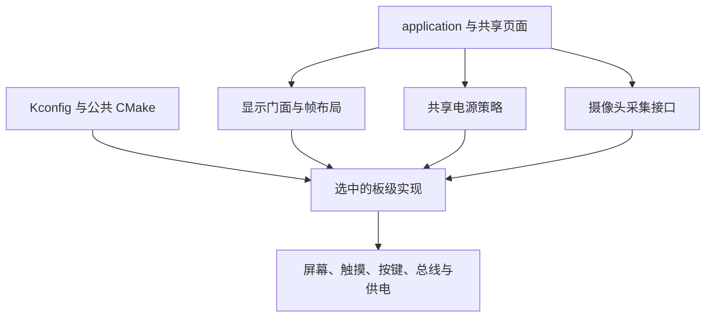
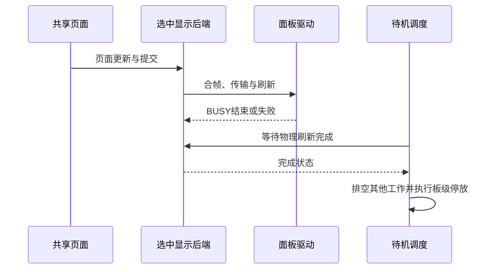

# 多板型框架与硬件接入

[English](hardware-adaptation.md)

双板验证用例、结果及回归范围见[硬件测试表](hardware-test-matrix_zn.md)。

## 范围

工程共享阅读、页面、对话、协议、音频处理与数据存储业务。板级选择决定芯片、屏幕与摄像头后端、连线、电源动作、字体和图片资源。每个构建只包含选中板型的硬件实现，不在运行时探测并切换整套板型。

软件按 `sysmgmt`、`business`、`infra`、`ui` 分工，硬件实现集中在 `boards`，资源集中在 `assets`。`Board` 继续承担现有设备入口，新硬件协作通过对应公共接口接入，不扩展为通用业务管理器。

支持以下构建配置，国际版复用同一硬件目录：

- `470`、`470-global`：`metalio-e-ink4-plus`，ESP32-S31，EPDiy。
- `397`、`397-global`：`metalio-e-ink-4`，ESP32-S3，SSD1677。

硬件身份沿用各板原有标识。不要把不同连线的硬件伪装成同一板型，固件发布与烧录必须使用匹配的配置。

固件依赖 SDK 的 C++ 异常支持执行内存不足恢复；公共默认配置启用 `CONFIG_COMPILER_CXX_EXCEPTIONS`。异常应急内存池同时保留公共默认配置规定的下限。已有构建目录需在对应 `sdkconfig` 中同步更新这两个选项，单独为 `main` 添加编译参数不能替代 SDK 配置。异常支持的代码与内存开销需计入各板的分区和 RAM 预算。

各板的自有 `main` 使用 CMake 跨文件优化，应用链接启用相应策略；SDK 和第三方库保持独立编译，异常展开信息继续保留。FreeType 的模块注册由 `main/ui/common/drawing/font/freetype_modules.h` 维护，匹配阅读与转换入口接受的 TrueType/OpenType 格式，保留 CFF、字体提示和渲染器。此清单可被 FreeType 多次包含，不添加头文件保护。编译策略调整不改变应用接口版本或持久化格式；工具链升级仍须核对包装入口、字体输出和设备运行。

## 目录结构

```text
main/
├─ app_main.cc
├─ CMakeLists.txt, Kconfig.projbuild, idf_component.yml
├─ sysmgmt/
│  ├─ application.*, application_tasks.cc
│  ├─ power/power_lifecycle.*, power/policy/
│  ├─ time/network_time.*, audio/audio_runtime.*, display/, diagnostics/, ui_startup.*
│  ├─ device_state.*, device_state_event.*
│  └─ system_info.*
├─ business/
│  ├─ reader/, app_store/, workbuddy/, yunxin_binding/, mcp_tool/
│  ├─ cloud/, transfer/, wallpaper/, haptics/, checklist/, weather/
│  ├─ network/, bluetooth/, diagnostics/
│  └─ conversation/
│     ├─ chat_cloud.h, chat_memory.h
│     ├─ yunxin/
│     └─ vision/camera_vision.*
├─ infra/
│  ├─ audio/
│  │  ├─ audio_service.*, audio_service_capture.cc
│  │  └─ processors/pcm_audio_processor.*
│  ├─ network/http/, endpoints/, time/
│  ├─ image/raster_image.h, image_decode.*, image_stream.*, image_overlay.cc, jpeg/
│  ├─ protocols/                      # WebSocket, MQTT, MCP
│  ├─ diagnostics/firmware_memory.h
│  ├─ ota/
│  └─ storage/settings.*, sd_paths.h, sd_layout.cc, sd_data_layout.*, sd_file_commit.*, sd_work_file.h
├─ ui/
│  ├─ application_ui.*              # 应用与公共导航的绑定入口
│  ├─ home/
│  ├─ apps/                         # book, assistant, workbuddy, app_store, cloud, wallpaper, checklist
│  │  ├─ settings/                  # network, bluetooth, pager, settings_test
│  │  ├─ standby/
│  │  └─ update/
│  └─ common/
│     ├─ runtime/                  # lifecycle, navigation, input/, lvgl/
│     ├─ widgets/                  # shared controls and presentation
│     └─ drawing/                  # display, adapter/, rendering/, font/, a2ui/
├─ assets/
│  ├─ device/, fonts/, embedded/, factory-test/
│  ├─ locales/, lang_*.h, lang_home.cc
│  └─ profiles/compact/
│     ├─ resources.list
│     └─ device/
└─ boards/
   ├─ metalio-e-ink-4/
   │  └─ metalio_e_ink_4_board.cc, config.h, sdkconfig.defaults
   ├─ metalio-e-ink4-plus/
   │  └─ metalio_e_ink4_plus_board.cc, config.h, sdkconfig.defaults
   └─ common/
      ├─ board/, bus/i2c/, bluetooth/
      ├─ audio/                       # audio_codec.*, bluetooth/, 其他现有音频驱动
      ├─ display/ssd1677/, epdiy/      # epdiy 内含 panel/, tps65185/, waveforms/
      ├─ input/buttons/, touch/
      ├─ camera/uvc/, dvp/
      ├─ power/bq27220/, cx25601n/, topology/, s31_sleep/
      ├─ rtc/pcf8563/, sensor/sc7a20h/
      ├─ io/pca9555/, tca95xx/
      ├─ haptics/vibration.*
      ├─ storage/
      └─ monitor/system_monitor.*
```

## 模块边界

UI按首页、应用和公共部件组织。页面拥有控件树、界面定时器与订阅；离页时解除订阅并使旧结果失效。业务操作的取消、保存和资源释放由对应功能域负责，离页不等同于操作完成。

阅读偏好及NVS迁移由 `business/reader/book_reader_prefs.*` 管理；ELF数据事务由 `business/app_store/app_data_store.*` 管理。两者不包含UI头文件。对话模块经 `conversation_presentation.h` 交付状态和意图，实现位于UI侧，不传递LVGL控件。系统提示入口为 `sysmgmt/system_notice.h`。

内置应用由 `ui/application_ui.*` 统一登记名称、图标与首屏，首页只维护主题排列。首页和待机使用应用标识打开待办，待机入口先完成硬件唤醒。`business/checklist` 独立提供刷新、删除和完成能力，开机、百问和待办页共用请求互斥及缓存提交；页面只持有只读结果和显示快照，离页不影响业务收尾。业务发布结果前归还网络占用，批量操作保留重试和部分成功语义。

首页和待机通过 `ui/common/widgets/weather_view.*` 独立订阅天气快照，刷新任务归 `business/weather`；网络和云端复用公共二维码。应用初始化绑定首页工厂、切页准备及网络入口，公共导航不包含具体页面。应用ID、NVS键、持久化路径与ELF ABI不因目录调整改变。



`sysmgmt` 管理生命周期及跨功能流程，`business` 管理产品业务，`infra` 提供通用基础能力，`ui` 管理页面和应用绘制。目录归属不代替依赖审查，也不引入统一能力基类或事件总线。

公共传输、云资源、清单、天气、壁纸选择和震动偏好归入对应业务模块；聊天记录由对话模块管理。页面提交操作并展示结果，不承担这些服务的持久化和网络协议。公共下载与取消控制位于 `infra/network/http`，音频帧类型位于 `infra/audio`。

电源、待机、低电保护关机和功能暂停恢复由系统生命周期协调。PCF8563 驱动与中断适配位于 `boards/common/rtc/pcf8563`，397 的 RTC 和 SD 启动装配由其板级实现维护，UTC 同步和旧格式兼容位于 `infra/time`；设备信息与内存诊断分别位于 `infra/platform` 和 `infra/diagnostics`。启动装配在内部 RAM 栈直接调用首页样式、阅读偏好和触摸分区各自的恢复入口，并分别恢复震动、壁纸及阅读快照，然后创建显示与触摸线程。显示后端不恢复业务数据。前光各界面入口共享完整快照保存通道；首页样式、语言、主题、触摸分区、震动和充电电流也由各自所有者合并后台保存请求。异步保存请求成功只表示已接纳，工作任务优先处理最新快照，同一快照最多尝试三次；持续失败保留当前内存状态及待保存请求，后续请求可重试。云服务、网络模式及本地播报开关须成功提交后才发布新配置，失败不执行相应重启或停止播报；震动反馈脉宽由振动配置维护，UI 只处理触摸反馈时机和有效热区。

`Application` 只负责启动装配、节拍和跨域调度，对外仅保留启动入口。`SystemState` 保存整机阶段、运行投影和启动占用，不持有业务对象；普通模块只能查询，由启动、会话、升级和重启拥有者受控发布。`Starting/Running/Updating/Restarting/Failed` 与会话状态独立，升级收尾不能覆盖已接受的重启阶段。`SystemControl` 合并重启请求，队列满时保留请求责任。

`business/conversation/conversation_controller` 拥有协议、会话代次、聆听意图与照片问题；厂商文本和协议交付分别在领域内部实现。请求与内部执行分开，协议只在会话控制线程或尚未就绪的启动线程访问。带参数的准备请求在队列满、音频模式等待和取消重试中保持同一代次；未完成建立的协议同样需要收尾。`chat_activation` 拥有配置请求阶段与绑定状态，`activation_polling` 管理互斥、嵌套暂停和待绑定验证码。

`TaskExecutor` 的 `NetworkIo` 通道承接较长网络作业，使用按需创建的 PSRAM 栈，不占用联网控制通道；工作完成后按既有空闲策略退出。

`TaskExecutor` 提供有界串行工作队列，由资源所有者控制空闲线程保留，不查询产品页面。`sysmgmt/audio/audio_runtime` 唯一持有共享音频服务、调用方占用和待释放请求，初始化成功后才发布可用；队列满时保留释放责任。待机检查所有音频工作，包括产测占用、仍在退出的线程和待释放任务。产测以电源需求声明活动，不再保存、覆盖和恢复会话枚举。普通任务、状态读取、音频占用及显示后端不依赖 `application.h`。

网络授时的联网准入、网络占用及板级通知由 `sysmgmt/time/network_time.*` 协调；`infra/time/time_service.*` 负责 RTC 与系统时钟转换及旧格式兼容，NTP 实现位于 `infra/network/time`。共享音频运行时属于系统服务，持有消费者占用及产品准入规则；音频采集、编解码与输出能力保留在 `infra/audio`。

云传输页面在 `ui/apps/cloud/cloud_screen.cc` 协调列表、选择、资源操作及模式切换，页面状态不对外开放。`CloudPreview` 独立持有预览控件、输入快照、加载请求、图像缓冲及取消收尾，通过保存意图回调交回页面，不访问列表或传输状态。USB 面板自持控件、容量结果与订阅，页面只负责装配及复位；业务请求仍由 `business/cloud` 和 `business/transfer` 持有。

文件传输网页的布局、样式、脚本和标识图片由中英文共用。构建生成的入口页面仅保存对应语言字典；设备直接发送 gzip 资源，由浏览器解压并渲染。

显示适配器通过 `ui/common/runtime/display_ui.*` 接收应用装配绑定的启动页工厂、延后恢复工厂、关机前页面收尾和波形占用查询，不包含书库、助手、首页或产测页面头。应用入口维护页面选择及恢复优先级；适配器维护刷新冻结、系统就绪时机和物理输出。波纹翻页的正文区域由阅读页随请求提交，后端不查询阅读页几何状态。待机像素通过 `sysmgmt/power/standby_wallpaper.h` 的呈现端口提供，缓存及解码所有权仍由待机实现持有。

公共控件入口 `ui/common/widgets/screen_common.h` 声明状态栏、提示、公共样式及居中选项窗。选项窗使用无网点遮罩的竖排按钮，删除操作仅在确认后执行。导航接口位于 `runtime/screen_common_nav.h`，异步交付、完成对象和重绘合并位于 `runtime/lvgl/ui_dispatch.h`。新增调用直接包含对应职责的头文件。

中部窗口通过 `ui/common/runtime/modal.h` 的 `UiModal` 组合已有控件树，复用 `UiPageLifecycle` 管理身份。普通窗口的返回与 Home 短按交给取消回调，其他按键由窗口消费；不可取消的进度窗口使用锁定策略。登记实例须比控件树存活更久，控件删除时自动解绑，隐藏窗口不占用输入；输入按实际可见层级交给最上层窗口。取消后台任务与关闭视图分别由业务管理，异步停止期间窗口继续持有输入；离页默认复用取消回调，分级窗口可单独提供视图清理回调。新窗口只需登记内容根与回调，不在页面或各按键入口重复增加弹窗判断。下拉菜单独立管理，仅 OTA 升级进行中禁止；待机沿用仅响应唤醒的输入流程。

构建会运行 `python tools/checks/check_dependencies.py`：禁止基础设施引用业务、系统或 UI，禁止业务直接引用 UI，禁止私有头被所属目录外的模块引用。`tools/checks/dependency_boundaries.json` 按源文件和目标头明确登记既有板级装配、系统显示桥接及公共适配中的应用依赖；这些例外代表仍需维护的边界，不代表已消除反向依赖。新增例外须说明所有者，失去引用的例外必须删除。构建传入对应的 `compile_commands.json`，按包含目录解析项目、SDK 及生成头；缺失或有歧义的项目头、未知宏形式包含均使检查失败，FreeType 的已知宏映射按 SDK 定义识别。未解析的外部或工具链头会单独统计，可用 `--show-unresolved` 查看；这部分不计入边界覆盖，检查不代替完整预处理、链接或运行验证。

### 后台工作与维护入口

内置应用登记和打开入口位于 `ui/application_ui`；页面位于 `ui/home`、`ui/apps`，共享 UI 按 `common/runtime`、`common/widgets`、`common/drawing` 分工。`business` 持有软件能力，一个应用可使用多个能力，同一能力也可由启动、待机或其他应用复用。维护功能时，应一起追踪入口、业务请求、状态所有者、执行通道、完成提交和取消出口。

`TaskExecutor` 提供八个有界通道：内部 RAM 栈的 `Voice`、`Network`、`Storage`、`Audio`、`Cleanup`、`Transfer`，以及 PSRAM 栈的 `NetworkIo`、`Image`。长网络请求与联网控制分开，取消与被取消的工作分开，Flash/NVS 操作保留内部栈。投递失败表示未接纳，由调用方恢复状态或保留请求责任；工作对象持有输入、取消令牌、进度和资源。空闲线程按所有者需求保留或退出，所有自有代码的动态任务通过 `infra/tasks/task_create.h` 的 `FirmwareCreateTask()` 创建，统一串行完成内部 RAM 准入检查与 SDK 分配，保留原核心、优先级和栈位置；实际分配失败时，参数和请求责任仍归调用方。任务创建与 JPEG 内部工作区回退分配共用预算锁，检查和分配在锁内完成；其他堆分配不受此锁保护，仍须遵守内部 RAM 安全预算。依赖检查禁止绕过此入口直接创建动态任务。

- **待办**：`business/checklist/checklist_service` 在 `NetworkIo` 完成请求、批量重试、部分成功和缓存提交。启动同步、首页、百问、待机及待办页共用入口与缓存。业务忙碌状态保护操作，页面忙碌状态只控制呈现；离页解除接收，不影响缓存提交及网络占用释放。
- **壁纸**：`business/wallpaper/wallpaper_service` 串行接纳选择、删除和保存。选择、删除使用 `Storage`，保存、普通预览及缩略图使用 `Image`；能力提交阅读背景设置并使缓存失效。取消保存在文件提交前生效，批量取消在当前条目清理后停止。`SdDirectoryPage` 管理列表扫描、预取及介质代次。待机和关机保留各自显示会话、解码及受控 SD 访问约束。
- **云资源与传输**：`business/cloud/cloud_resource_service` 持有列表、删除、下载、冲突及预览请求。列表和删除使用 `NetworkIo`，保存使用内部栈 `Transfer`，取消使用 `Cleanup`；同名冲突等待归还通道，继续投递失败保留请求，已提交文件不因回执失败回滚。`business/transfer/transfer_session` 合并热点、局域网、USB 与关闭请求，独立控制线程避免停止流程等待自身排空。切换无线模式前等待手动配网退出。USB 容量查询在 `Storage` 执行并校验介质代次。
- **网络与蓝牙**：`business/network/wifi_setup` 持有扫描、连接、配置提交、重启和驱动借用，一次手动会话使用一个内部栈控制线程；关闭只提出取消，工作线程完成事件解除与驱动清理。`WifiRadio` 协调手动配网、后台联网和热点的占用。`network_settings` 在 `Network` 执行配置及 SIM 操作；`NetworkModemSession` 使设置、信号采样与蜂窝产测的跨命令事务互斥。`business/bluetooth/bluetooth_control` 持有模式、扫描、命令、设备快照及音频协作，页面只提交操作和显示快照。
- **设置与产测**：主题、语言、首页样式、阅读偏好、触摸分区、前光、震动及电源偏好由各自所有者合并快照并使用 `Storage` 保存。`conversation_settings` 的远端设置使用 `NetworkIo`，本地播报在 `Voice` 提交并生效，云服务选择在 `Storage` 提交后重启。`business/diagnostics` 持有 Wi-Fi、摄像头、蜂窝、老化、日志上传及 VCOM 流程；硬件会话保留必要的独立线程，取消后先恢复设备再发布终态。老化节拍由业务维护，保存、音频及 SD 工作不依赖页面更新，重启记录提交完成后才移交重启。日志上传使用 `Transfer`，占用及 HTTP 由会话收尾。
- **阅读**：`business/reader` 持有文档、游标、分页、进度及缓存，`reader_page_job` 从独立快照准备正文。打开、排版、章节统计、字体、预取、插图和封面保留所需并行、栈预算及取消令牌，避免互相等待的任务进入同一串行队列。书籍删除由 `book_delete` 在 `Image` 执行；书签编辑提交 `book_bookmark_jobs` 的独立存储快照，保存成功后页面接入结果。书签、进度和阅读首页快照保存使用 `Storage`，排队事务预留 SD 访问。完成对象或固定交接槽通过公共完成通道唤醒 UI；离页后的延后清理继续推进，待机等待读取者退出后再释放字体、会话和句柄。
- **百问与 WorkBuddy**：`conversation_controller` 持有会话和照片问题，`conversation_photo` 持有拍摄、图片缓冲、上传及取消；捕获使用 `Image`，上传使用 `NetworkIo`。界面管理缩略图、预览、历史呈现及控件。`business/workbuddy/workbuddy_session` 持有授权、语音轮次、请求和音频收尾，长轮询与流式请求保留有界独立线程；页面通过快照和生命周期接收结果。旧轮次不能发送新会话消息，失去接收者不转移音频或网络清理责任。
- **应用商店与 ELF**：`AppStoreSubmit` 在 `NetworkIo` 执行请求、安装和重新扫描，作业持有取消与进度，页面保留选择、队列呈现及导航。`business/app_store/app_executable` 在内部栈加载 ELF 并拥有映像，页面退出后由最后一个所有者回收；UI 只装配应用接口和控件。应用 ID、导出接口、函数表及持久化格式保持兼容，已发布 ELF 不重新生成；设备上的旧二进制运行仍需硬件验证。
- **天气与硬件**：天气请求同时提交 NVS，保留内部栈工作线程。触摸、按键、传感器、调制解调器收发、USB/UVC、显示扫描与供数、音频采集和输出由驱动或服务持有持续任务。摄像头 DVP/UVC 采集适配位于 `boards/common/camera`，预览控件属于 UI。字体转换、A2UI 及目录扫描按实际缓存、时序和取消条件工作。

定时工作按职责区分：业务期限及老化节拍由能力持有，设备脉冲及供电时序由硬件持有，时钟、动画和结果展示由 UI 持有。`UiPageLifecycle` 统一绑定普通页面和叠加层的更新、待机及离页钩子；卸载使旧身份失效，删除解除登记，不可见叠加层不接受周期更新。业务请求和缓存不交给页面生命周期管理。

`application_ui` 保留应用登记、装配与导航入口；公共循环处理输入、异步交付、生命周期更新及触摸反馈，不逐项枚举应用的 `Poll`、`Pause` 或 `Resume`。阅读的字体、SD 和延后清理顺序由阅读协调器维护，生命周期只转发页面事件；无需更新的静态页面沿用公共导航和控件树释放。

`ScreenCompleteWork` 使用完成对象自身的链结交付已接纳工作的结果，普通结果与紧急资源收尾各保留 FIFO，每次更新分别消费，避免结果积压阻塞资源归还。回调接管对象并校验页面或会话身份；业务提交和操作占用释放在发布前完成。普通进度及导航消息继续使用有界 `ScreenLvAsync`，未接纳时责任保留在发送方。

日志上传与 VCOM 产测流程位于 `business/diagnostics`。VCOM 的蓝牙芯片记录读写、刷盘与读回校验由 `boards/common/display/panel_calibration_storage.*` 负责，不依赖 EPDiy 渲染实现，显示电压应用和界面提示在装配时绑定；既有记录槽、数据格式与电压范围保持兼容。仅支持该校准能力的板型链接相应后端及提示实现。

OTA 基础能力位于 `infra/ota`：`firmware_image` 负责 URL/SD 镜像头检查、分区写入、SDK 完整性校验和启动分区选择；`firmware_ignore` 保持已有忽略版本记录兼容。这些实现不依赖系统调度、对话或页面。`sysmgmt/update/FirmwareUpdate` 负责开机与手动检查策略、用户确认、执行准入、音频收尾、失败后的会话恢复和重启协调，不直接操作 Flash 分区。设置页提交检查、显示结果和交付用户选择，不创建专用网络线程、不自行比较版本，也不截断下载地址。SD 固件仅在成功后移除，失败保留源文件。

`infra/network/device_config_client` 是设备云配置协议客户端，提供固件元数据查询及对话配置、激活请求，不比较版本、不写镜像、不控制升级界面。对话查询接收产品域的 `CloudConfiguration` 快照，固件查询不接纳对话凭据，对话查询不接纳升级信息。请求共享有界重试和时间预算，取消在联网、重试及响应提交前检查；底层阻塞请求仍受超时约束，取消不代表立即中断所有网络调用。升级检查使用产品配置入口，不维护失去用途的 NVS 地址副本。通用 HTTP 客户端的 `ReadAll()` 边读边释放接收队列，完整响应限制为 1 MiB；大文件使用分块 `Read()`。

WebSocket 与 MQTT 接收产品域的配置快照，不反向引用对话业务；MQTT 的任务投递和重连许可由调度方注入。协议接收资源在内核对象创建成功后才可启动，传输销毁先于其事件组释放。客户端握手共享构造与失败处理，服务端音频元数据在协商及解码入队时校验。协议销毁先封闭重连入口，再等待已派发的定时器回调退出；音频任务的分配失败按当前帧或采集代次收尾。MCP 核心负责解析、分发和响应；JSON 节点、打印缓冲及工具结果由当前调用持有，序列化或设备快照失败不会作为成功响应或请求正文发送。设备工具及视觉会话配置由 `business/mcp_tool` 装配，系统仅注入升级、重启和会话发送入口。回调接收方须在协议接收前初始化，并保持有效至会话停止。

显示控制器、波形和硬件传输留在 `boards/common/display`；依赖页面、输入交付和应用生命周期的显示组装及 LVGL 适配放在 `ui/common/drawing/adapter`。音频硬件接口和器件实现留在 `boards/common/audio`，PCM/Opus 处理放在基础能力域。

470 的普通 DU/GL 局刷在同次刷新内对整页纯黑目标统一推黑，不受差分脏行列限制；未变化的灰白像素保持。该策略复用当前波形相数，完整刷新、清屏和测试波形保留各自路径，黑色浓度与刷新耗时仍需硬件验证。



刷新失败或超时不能按成功处理。关机画面、待机停放和刷新中导航必须分别验证，不能用一次提交返回替代物理完成。

### 构建与资源

`main/Kconfig.projbuild` 分别选择硬件板型与国内/国际产品版本。`main/CMakeLists.txt` 显式选择板级入口、后端源码、头文件目录、组件依赖及嵌入资源，不递归收集整个公共硬件目录。每个板型只维护组装入口、`config.h` 与 `sdkconfig.defaults`。器件实现按功能和型号放在 `common`，引脚、地址和校准参数以板型配置为权威源。

USB 制造商与文件传输热点名称前缀分别由板级 `BOARD_USB_MANUFACTURER`、`BOARD_AP_SSID_PREFIX` 提供。

`config.h` 中的 `BOARD_*` 配置限定前光、VCOM、灰阶、刷新档位、翻页效果、CPU档位、充电电流及产品字体规格。`BOARD_BOOT_LONG_PRESS_MS` 与 `BOARD_POWER_LONG_PRESS_MS` 分别维护 BOOT/侧键和电源关机的长按阈值，实体键、触摸键及待机判定共用所选板型的数值，单位为毫秒。页面不得通过板名或无关能力猜测硬件。`BOARD_REFRESH_PROFILE_MASK` 按持久化枚举声明可用档位，`BOARD_REFRESH_PROFILE_DEFAULT` 声明默认值；后端还须校验波形资源。`BOARD_HAS_VCOM` 与前光能力独立。

`BOARD_FRONTLIGHT_MAX_OUTPUT_PERCENT` 限制前光各 PWM 通道的占空比，范围为 0–100；`BOARD_VIBRATION_FEEDBACK_PULSE_MS` 按弱、中、强提供三个正值脉宽，由板级装配传入现有振动配置。`BOARD_BATTERY_FULL_EXIT_MV` 与 `BOARD_BATTERY_FULL_MV` 维护满电显示滞回，退出电压须低于确认电压，不控制充电截止。`BOARD_DISPLAY_PARTIALS_PER_FULL` 与 `BOARD_DISPLAY_FULL_REFRESH_MIN_INTERVAL_MS` 同时满足时允许周期清残影；次数须为正，间隔 0 表示不限制。首帧、待机与失败恢复等强制全刷不受最短间隔限制。

充电电流的选项、默认值与执行校验共用板级配置，调整前须核对电池与充电电路限制。用户保存的CPU档位和阅读特效在公共读取与执行路径统一校验。

板级配置维护阅读默认边距、行距、段距、抗锯齿、翻页间隔与方式、底栏选中项和目录行数，以及主题、首页样式、语言、云服务和空闲保网时长的默认值。已有用户设置优先；偏好校验与界面调节共用范围，恢复默认使用同一配置。阅读信息支持“全部底部”和“上下分栏”布局，信息位置及预留空间见[UI 调度](ui-scheduling_zn.md)。目录按完整字体行适配，空间不足时减少行数。策略实现及持久化预设索引仍由所属模块维护，修改枚举值须处理兼容性。

### 显示与UI

页面通过 `lv_adapter_display.h` 的 `LVAdapterDisplay` 使用选中后端，不直接引用 `LvAdapterEpdiy`。这是编译期门面，不是运行时插件系统。新增后端时，补齐公共调用所需的方法并明确不支持的操作，不以返回成功掩盖未完成刷新。

系统提示使用 `sysmgmt/system_notice.h`，会话、绑定、待机和升级分别使用所属功能的呈现端口。电源协调仍通过显示门面处理物理刷新与硬件收尾；页面暂停与恢复由生命周期按既有阶段转发。阅读偏好和触摸分区配置归入 `business/reader`，持久化键与动作编号保持兼容。

`ScreenPollPendingWork()` 位于公共运行层，按顺序调用装配时绑定的导航钩子、异步交付、页面更新和触摸反馈；后端不通过该入口查询应用登记。具体触摸采样和物理按键由对应输入实现负责。`UiInputPoll()` 是两种显示后端共用的按键业务入口：GPIO与扩展器实现均提交已识别的逻辑手势；翻页、音量和业务限制只在公共分发器维护。待机期间电源键锁存由低功耗任务独占。队列溢出或采样异常会取消当前手势及连翻，恢复前不使用旧电平合成单击或关机。

`EpdGetFrameBuffer()` 返回缓冲指针、物理尺寸、步长和像素格式。调用方只能在UI上下文或持显示锁时借用，不得释放、跨异步任务长期保存或按固定4位像素计算容量。`EpdWait()` 等待刷新收尾；LVGL缓冲可复用不代表物理刷新完成。合并的中间画面不保证逐帧上屏。

397保持自己的BUSY、合帧、维护全刷与灰阶路径，页面切换不增加推白；470保留原刷新策略。方向映射只在公共坐标层执行，驱动不得重复旋转触摸。

### 界面所有权与自适应

公共UI提供状态栏、顶部提示、中部弹窗外观、系统字体、语义颜色、选项控件、输入策略及刷新协调。应用持有自己的父子容器、局部样式和异步资源；外部模块通过应用入口协作，不按子控件索引调整应用布局。公共控件只负责自身内容，不重新布局所属页面。

固定区域显式关闭无用滚动；允许纵向溢出的区域保留滚动。页面按父容器实际内容宽高、系统字体行高及文字测量安排布局，尺寸计算不重复扣除父级内边距。阅读菜单共用一个底部导航及内容区边界；传输页按文字占用分配二维码空间，二维码保留整数模块及静区。过长文本或较小可视区域可滚动，不以任意缩小字体或裁切内容解决溢出。

普通文本只使用本机Flash系统字库的现有规格，不使用LVGL内置字体兜底。 原生LVGL单色主题也绑定本机系统字体，未显式指定字体的控件继承同一来源。应用包请求不支持的界面字号时保留当前字体，不把数学专用规格用于普通文本。系统界面字体是必需资源；固定区域适配只尝试已配置的完整界面字号。数学专用字形、图标和时钟属于独立资源；阅读者选择的SD字体仍由阅读模块管理，同规格缺字扩展不改变系统字体来源。

设置的主题页暂不提供界面明暗切换入口；`ui_theme.*` 保留语义前景、背景及装饰色，以及明暗模式能力供后续接入。普通正文与内置阅读背景随明暗变化；照片、封面、壁纸、自定义阅读背景、二维码及显示测试图案保留原色。明暗偏好由内部RAM栈任务持久化，不新增整屏反色缓冲。应用不直接写物理帧缓冲来实现主题。

二维码由 `ui/common/widgets/ui_qrcode.*` 统一创建外框、黑白配色及静区；配网、文件传输和账号绑定使用同一 LVGL 二维码控件，页面只分配可用边长，不单独计算码区占比。

系统界面字体通过 `ui/common/drawing/font/ui_fonts.*` 的 `UiFontRole` 统一选择。字号、字重和回退映射只在 `ui_fonts.cc` 维护：正文、标题及其强调角色均跟随产品默认字号，标题强调只改变字重，不放大字号；辅助说明使用板型配置中的辅助字号。页内状态提示统一采用正文角色，页面不再直接指定字号或把 bpp 当作字重。阅读正文的用户字体、数学公式、图标字体及外部应用显式声明的字号保持独立接口。

板型 `config.h` 统一维护 `BOARD_UI_FONT_SIZE`（常规）、`BOARD_UI_LARGE_FONT_SIZE`（大号）和 `BOARD_UI_CAPTION_FONT_SIZE`（辅助）三档。397 的默认配置分别为 25、25、25px；470 分别为 30、30、25px。导航标题使用常规字号的强调角色；日期天气、阅读统计数值、书籍内容标题、键帽及对话正文等大号内容显式选择 `Large`／`LargeEmphasis`。页面不判断板型、不写具体字号。当前系统字库完整支持 25、30px；配置其他字号前须补齐资源与规格校验。

文字控件使用 `screen_text.h` 的实际字体行高度量；纯文字按钮按内容换行增高，原设计高度作为最小值。阅读字体网格、设置行及父面板同步计算高度；目录、书签和导航不叠加标签模拟加粗。更换系统字体资源后应重新创建页面并核对中英文及窄屏布局，同字号不代表相同行高或文字宽度。

阅读设置的强调文字使用单个标签：30px 选择字库中的 Semibold，25px 在 LVGL 字形绘制缓冲内向右扩展一像素合成加粗，保留原步进、行高和基线。合成处理不修改 Flash／SD 字形，也不增加位图缓存；实际笔画效果须在目标墨水屏上检查。

后台结果持有独立请求对象；页面代次及介质代次决定能否发布。离页不取消服务端已经成功的操作，清单删除和完成结果仍更新业务缓存。消息入队失败由发送方回收参数；清理不能依赖一个可能满载的普通消息队列。USB容量查询由存储所有者在公共通道完成，页面只消费结果，不同步遍历文件系统。

`ScreenFixedFooter` 组合可伸缩内容区和固定操作栏，分隔线属于操作栏，只有内容区允许滚动；父控件销毁时清空引用。页面保留自己的分页数据与业务状态，不依赖子控件序号定位内部结构。弹窗操作按钮复用 `ScreenLayoutTextButton()`，操作行随内容增高；公共键盘提供首选高度，输入页面不重复推算键盘尺寸。此类公共控件通过组合使用，不要求所有页面继承一个页面基类。

### 电源、总线与摄像头

共享电源策略和待机调度位于 `sysmgmt/power/policy`；`sysmgmt/power/power_lifecycle.*` 统一联网恢复、关机任务及失败回退。公共 `power_hw.cc` 管理调频保持与系统协作回调，构建清单只选入一个 `topology` 实现。拓扑实现不引用应用或页面，只处理供电、保持、停放及唤醒时序。关机任务栈沿用各板配置的容量和内存类型。

待机先完成画面及启动、网络、音频和存储排空，再停放SD与外设。入睡前等待超时只取消本次入睡并请求恢复界面，不能越过在途事务强制断电；硬件恢复失败时保留唤醒请求并限频重试。关机准备失败保留供电，恢复输入、刷新和策略状态。397共享主电源不能作为普通空闲或蓝牙单独复位开关。

Flash操作通过 `FlashAccessGuard` 统一按缓存门闩、共享总线、SDK的顺序接纳；同任务嵌套只排空和释放一次总线。波形及其他连续缓存操作只使用 `FlashCacheGuard`。OTA、NVS、资源写入和崩溃转储共用接纳逻辑，业务不得直接调用内部总线钩子，也不得跨网络、UI回调或普通SD等待持有总线。

`power_hw_boot_prepare()` 在外设初始化前完成复位记录与启动引脚恢复。输入模块以逻辑BOOT/POWER键交付状态及事件；`InputSamplingPause` 以引用计数暂停触摸采样，不包含OTA业务名，也不靠无操作板级函数占位。Flash接纳层负责等待在途总线事务，ISR不调用任务态的暂停查询。

`Camera` 仅提供JPEG采集及硬件控制，唯一接口位于 `boards/common/camera/camera.h`。MCP配置和视觉请求由 `camera_vision.*` 统一处理，单次调用持有照片，上传不占用摄像头会话；两个硬件适配器不保存服务地址或凭据。公共上传请求使用30秒期限和64KiB结果字节上限，读取不完整或超限按失败处理。摄像头检测和预览通过 `boards/common/camera/camera_capture.h` 接入；工作任务持有结果，页面代次决定是否发布。DVP和UVC分别实现采集，取消不能跳过关闭会话、恢复路由和释放供电。UVC 采集先停止根端口、切回路由，注销 UVC 并排空设备，再停止事件任务、卸载 Host 与 PHY；收尾后恢复 Serial/JTAG 并归还 USB 角色，硬件释放失败时保留占用。USB 摄像头和虚拟磁盘在采集期间不能同时占用同一 USB 硬件。

### 联网状态、存储与图像所有权

`Board::GetNetworkStatus()` 返回联网介质、阶段和原始信号。图标与语言提示由 `ui/common/drawing/rendering/network_status.*` 映射，网络就绪检查必须由具体实现提供，基类不默认返回成功。

`infra/network/wifi_radio.*` 协调传输热点与低功耗的射频占用，持有驱动初始化、热点接口和原 STA 模式的恢复责任。业务只请求启停热点；低功耗通过同一入口暂停和恢复。用户关闭网络优先于自动恢复；策略空闲停网不禁止用户主动启动热点，真正待机期间拒绝新占用。启动失败会尝试恢复，恢复失败保留状态供重试。

`DownloadGate::Binding` 在 HTTP 所有者之后声明，统一解除连接借用并可选择在工作任务退出时关闭连接。UI 只标记取消，阻塞中断仍由清理任务执行；取消标志不代表工作任务或 SD 事务已释放。

`infra/storage/sd_paths.h` 维护应用目录与兼容文件名，`sd_layout.cc` 登记目录依赖并按需准备父目录。系统固定目录通过 `SdEnsureDirectory()` 准备；用户子目录继续由业务校验。`sd_work_file.h` 统一 HTTP、壁纸保存和图像解码的工作区选择、随机名称及独占创建，调用方持有 SD 事务并负责文件生命周期。持久数据路径和书籍旧旁路数据保持兼容；公共图像解码使用独立工作区，不再借用壁纸工作区。缓存清理只匹配已知前缀，不清空临时目录或恢复备份。

`Settings::Commit()` 同时反馈批次写入与提交错误。提交失败保留待提交状态，允许调用方显式重试；析构不重复执行已失败的提交。字符串、整数及布尔写入接口返回暂存结果。

`SdCommitFile()` 接收已刷盘关闭的文件，统一目标冲突检查、原文件备份、替换和失败恢复；目标缺失时恢复备份，目标与备份均为普通文件且允许覆盖时清理已完成替换留下的旧备份，再继续提交。它不提供 FAT 断电原子性或多文件事务，调用方仍须串行化同一目标的完整业务操作。应用安装的多文件恢复由应用商店管理。 `WriteFileAtomic()` 串行保护暂存写入与提交的完整过程，使用 `.tmp` 暂存和 `.backup` 恢复文件；替换失败先恢复原目标，恢复失败时保留备份供下一次提交恢复，不先删除原文件。

存储失败通过 `infra/storage/storage_error.h` 的 `StorageError` 交付，包含稳定分类、失败阶段、原始 `errno` 和 SDK 错误码。访问许可在申请时保存拒绝原因；目录页、容量查询、文件保存与提交将原因随结果传递。图片解码继续使用 `ImageDecodeError` 区分格式及像素处理失败，文件解码可另行返回存储错误；读取失败在关闭文件或恢复备份前保存，后续清理不覆盖首个原因。单根目录不存在返回明确错误，多根搜索目录允许跳过不存在的可选根。正常空结果、取消及业务重试策略由调用方处理。

界面通过 `ui/common/widgets/storage_error_text.h` 选择当前语言的存储提示；老化测试直接使用共享存储与解码结果，保留测试循环、恢复检测及日志限频。初始化或挂载失败不等同于确认未插卡。日志只记录固定分类、阶段和数值原因，不包含路径、文件内容或云服务地址。新增存储阶段应在原始失败点保存结果，避免接收方重新读取 `errno` 或根据设备当前状态猜测旧操作原因。

SD接纳层只管理访问与介质生命周期。启动入口登记同步缓存释放回调；书库版本及缩略图缓存检查挂载代次，USB交还介质后不复用旧内容。缓存释放回调在存储锁外执行，不得递归请求介质切换。

`infra/image/raster_image.h` 定义共享L8图像值，复制和移动后重新绑定像素描述符。通用尺寸探测、等比缩放尺寸计算和灰度压暗分别由同目录的 `image_geometry.*`、`image_tone.*` 维护，固件和桌面模拟器共享实现。硬件采集只处理硬件会话；预览尺寸、解码和界面结果交付由 `ui/camera` 组织。

通用解码入口、流式 JPEG/PNG 和透明叠加分别位于 `infra/image/image_decode.*`、`image_stream.*`、`image_overlay.cc`，渐进式 JPEG 位于 `infra/image/jpeg/`。这些实现只接收图像数据、文件或借用读取回调，不依赖阅读类型及 ZIP 业务对象。`business/reader/zip_image_decode.*` 负责条目的打开、重开、关闭及取消交接，并保留原有受限缓冲回退。文件替换写入由 `infra/storage/file_write.*` 维护，沿用 `.tmp` 恢复约定，不保证 FAT 断电原子性。

WebSocket和MQTT音频在读取包头、分配及复制前校验实际帧长、类型和载荷长度，载荷上限为65535字节；协议字段布局不变。MCP字符串消息上限为64KiB。异常消息日志仅记录阶段、长度和计数，不打印原始消息或远端传入的名称；连续异常限频记录。

## 音频能力

音频使用 PCM 通道处理与 Opus 编解码，保留按键发起的对话采集、播放、录音测试及独占 Opus 采集。系统协调采集启停和音频资源归还，处理器不持有设备生命周期。

工程不提供 AFE、设备端或服务端 AEC、唤醒词识别及原始音频调试发送选项，也不依赖 ESP-SR 或语音模型占位接口。协议音频帧的二进制结构保留，移除唤醒词通知和实时 AEC 模式。

图片与字体通过当前 `resources`、`font_data` 分区加载。资源目录名为 `assets`；不再提供依赖另一套 `assets` Flash 分区的主题下载入口。分区标签与源码目录名称属于不同概念。

## 构建与烧录

先激活ESP-IDF 6.1环境，在工程根目录执行：

```sh
python tools/firmware/build_board.py 470
python tools/firmware/build_board.py 397
python tools/firmware/build_board.py 470-global
python tools/firmware/build_board.py 397-global
```

配置、缓存和固件分别位于 `build/<配置>/`，不改写根目录的 `sdkconfig`。配置菜单使用 `python tools/firmware/build_board.py 397 menuconfig`，重新配置使用 `python tools/firmware/build_board.py 397 reconfigure`。一个构建目录只能用于一个配置；更改芯片或产品版本时使用另一个目录。

组件下载目录和依赖锁仍由当前工程共享，不并行运行不同芯片的配置或构建。需要并行时使用独立工作副本。

烧录选中配置时使用匹配的构建目录，例如：

```sh
idf.py -B build/397 flash
```

397保留自己的分区、原字库与图片。构建将图片资源附加到应用固件，板级启动在创建显示与映射资源之前调用 `infra/ota/resources_upgrade.*` 校验并更新资源分区；字库独立烧录。470继续使用既有资源方式。不要把一个板型的字库或分区表用于另一个板型。

397 摄像头 Host 与 USB Serial/JTAG 共用 PHY，采集期间控制端口会暂时断开，正常收尾后恢复。自动化测试仍须具备设备复位或独立电源/UART 恢复通道，以处理硬件释放失败。

## UI布局与资源

硬件配置、产品资源和运行时布局分别维护：

- 板级 `config.h` 声明连线、供电和显示能力；`BOARD_DISPLAY_GRAY_LEVELS` 决定书架是否生成显式黑白纹理。
- `ui/common/drawing/ui_profile.h` 根据 Kconfig 板型直接选择产品资源规格，统一维护默认界面字号、阅读字体、字号范围及文字回退候选，并提供只读访问。普通版与国际版复用同一硬件及资源选择。
- `display/ui_layout.h` 仅计算数量和图片比例，不读设备、不存储配置、不改变业务状态。`screen_layout.h` 在LVGL上下文取得逻辑内容尺寸，避免重复扣内边距。
- `screen_text.h` 统一测量、候选字体选择和空间不足时的省略；区域扩大时恢复原文后重新测量。默认界面字库不可用时，字体模块记录错误并缓存内置后备字体，页面不接收空默认字体。
- `screen_gesture.cc` 是两个显示后端共用的纵向手势判定；空列表与短列表允许公共下拉，实际可滚动列表和分页列表保留拖动。后端只负责采样、坐标转换及输入交付。

`SettingsCreateOptionGrid` 根据容器宽度和当前字体行高分列，尺寸变化时重新计算。通用选项由换行文字撑高，固定高度调用方仍使用统一文字适配。蓝牙和功耗选项复用这些控件。阅读设置采用同一数量计算，目录按内容高度和字体行高确定可见容量，保持章节、进度及选项位掩码不变。

设置的信息行按实际字体度量分配标题和右侧信息，扣除图标、箭头及间距后共享可用宽度，只有空间不足时才换行。非黑色灰度首页图标使用完整 AL88 解码，保留原始灰度和透明度，缩小时不按分块边界裁剪。

AP二维码根据父内容宽度和当前逻辑屏高选择画布，使用等大的整数像素模块和至少四模块静区。传输步骤按内容高度排列，超出时纵向滚动。待机及照片预览共用比例计算；标题和操作区独立占位。普通首页根据Hero实际底边安排应用区；斜切应用区约占顶栏下内容高度的一半，空间不足时按Hero底边收缩，图标复用经典主题的尺寸基准。首页图标优先使用内嵌资源并保留透明度，普通主题在空间足够时原尺寸居中显示，仅缩小时启用抗锯齿；像素主题保留独立缩放并关闭抗锯齿。像素主题保留自己的设计坐标，各主题统一约束数字、图标和标题边界。

I1 图像透明度按原生 ARGB 图像的混合规则处理，先在灰度域混合，再转换为黑白；A8 图像蒙版与文字落墨分别处理，保留文字原有策略。该路径不增加图像缓存或整帧缓冲。

页面持有显示快照、控件事件与页面订阅，公共生命周期管理更新及旧结果失效；布局计算不发起网络、存储或硬件动作。欢迎页和翻页器卡片依据实际文本高度排列，空间不足时使用已有纵向滚动区域。取消、过期结果丢弃、输入分发和离页释放沿用公共业务流程，不创建按板型复制的业务控制器。

新增同类硬件优先选择已有资源规格、声明能力并验证逻辑内容区。不得为尺寸适配在共享页面中增加板型分支、复制业务页或修改存储键。新交互方式或显示技术确需扩展时，在相应公共契约中实现并回归既有板型。布局模拟不代表字形覆盖、实屏灰阶、触摸和扫码已经验收。

## 新板接入步骤

397的接入配置位于 `main/boards/metalio-e-ink-4/`。该板使用SPI屏幕、I1帧、CST816S触摸、GPIO与扩展器按键、1位SDMMC和USB UVC摄像头；470继续使用原并行屏幕、4位帧和DVP摄像头。两板分别维护电源时序与波形，不能通过替换引脚表互相复用这些实现。397没有前光，公共设置、快捷菜单和产测页按能力隐藏相关操作。

397依赖固定的 `usb_host_uvc` 2.3.1及对应兼容补丁。LVGL I1补丁生成到构建目录，不修改共享LVGL源文件；升级组件时应同时检查补丁上下文与两种显示后端。

新板目录维护板级组装入口、`config.h` 和 `sdkconfig.defaults` 三个文件。已有驱动直接复用，新器件才在公共功能目录下增加型号实现；不复制整套硬件目录。

1. 核对器件、总线、供电拓扑、唤醒源和初始化顺序，在板级入口选择实现并传入必要配置。
2. 在 `main/Kconfig.projbuild` 注册硬件选项、芯片约束和派生后端；国际版由独立产品版本选项控制，不复制驱动。
3. 在公共 CMake 中明确加入该板源码、私有包含目录、组件依赖、资源规格和必要的二进制文件。未选中的后端不进入编译清单。
4. 板级 `sdkconfig.defaults` 声明目标芯片和必要差异。构建工具加载公共默认值、ESP-IDF 自动加载的芯片默认值、板级默认值与隔离的选择文件。默认值用于初始化，不覆盖已有 sdkconfig 的用户配置。
5. 使用 `python tools/firmware/build_board.py <板型目录名>` 构建，国际版加 `-global`；不同芯片与版本使用独立目录。
6. 完成双板构建、源码选择检查和受影响区域回归，再执行独立的硬件验收。

音频应答与模式初始化、充电电流管理、加速度采样缓存及系统监控共用一份实现。初始化参数保留不同总线、共享中断、UART、独立复位能力与既有存储键。振动配置将 GPIO/PWM 驱动方式与直连/扩展引脚分别声明；PWM 当前为软件定时实现，保留现有低频参数，扩展输出回调仅在任务上下文执行。GPIO 模式只创建脉冲定时器。摄像头独立于数值采样传感器管理。

紧凑资源配置通过 `resources.list` 限定最终文件集合，相同图片和字体复用公共文件，不同图片保留在资源配置目录。构建阶段合成资源包，不增加运行时查找层级。波形与触摸固件仍由对应硬件后端管理；关闭触摸升级时不嵌入升级固件。

构建只能验证编译与链接。BUSY、电源时序、引脚保持、唤醒、实际功耗、字体和页面显示必须在对应硬件验证；新增后端不能据构建成功宣称硬件兼容完成。

硬件验收应覆盖以下组合，分别记录两板结果：

- 初始化：正常启动、触摸缺失、IO扩展器无响应、SD缺失，以及已保存的旧版配置。
- 显示与输入：四向显示和触点映射、阅读抗锯齿、快速连续翻页、刷新中切页、长列表滚动、空列表和短列表下拉菜单。
- 电源：刷新期间请求待机、定时唤醒、POWER短按和长按、低电量关机、关机画面刷新失败；确认共享供电没有影响音频、蜂窝网络或摄像头。
- 存储与USB：SD写入期间退出页面、启停虚拟磁盘、插拔摄像头、拍照取消，以及摄像头和虚拟磁盘同时请求启动。
- 升级：正确板型固件、镜像超限、资源校验失败、写入失败和升级中断；恢复后检查字体、资源分区与保存的数据。

`Board` 提供设备入口，两个显示后端各自维护硬件状态机。新增板型优先复用已有后端和公共页面；模块拆分以实际职责和复用需求为依据。

强调位置由公共字体角色决定，不按型号区分。`BOARD_UI_EMPHASIS_NATIVE_BPP` 指定强调资源规格（0 表示直接合成），`BOARD_UI_EMPHASIS_EXPAND_PX` 配置资源缺失时的横向加粗宽度，支持 0（关闭）、1、2px。470 优先使用 4bpp 半粗体资源，397 直接合成；紧凑字号回退保持强调样式。bpp 表示灰度精度，实际字重取决于对应资源，不表示重复绘制次数。


## 硬件资料

板级引脚、外设地址和可调参数以 [470 配置](../main/boards/metalio-e-ink4-plus/config.h)及对应板型源码为准，不复制引脚表到产品 README。屏幕、触控及电源资料位于 [datasheets](datasheets/)；现有原理图与产品资料见该目录实际文件。397 使用独立板型配置，不能套用 470 的并行屏或 USB 接线。
